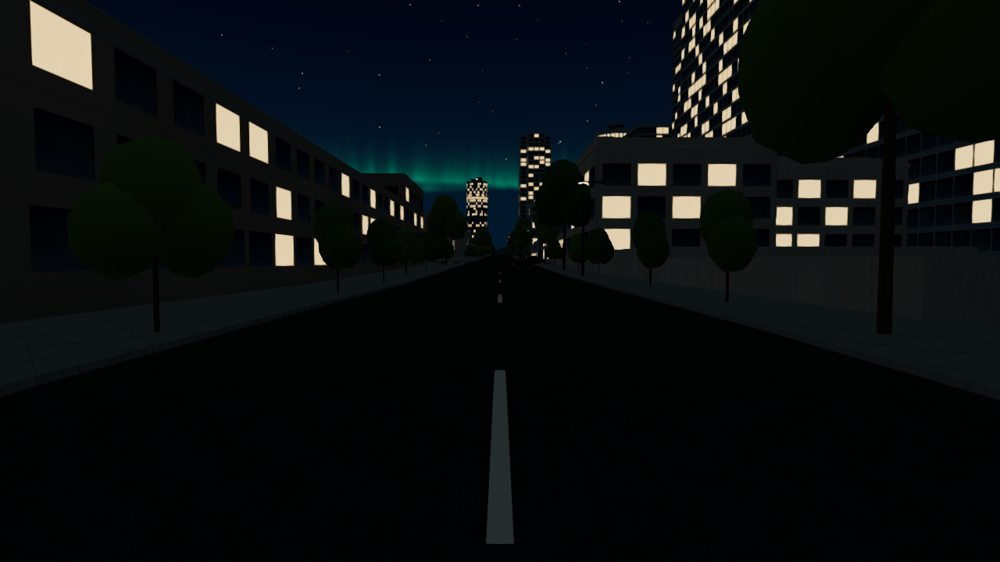
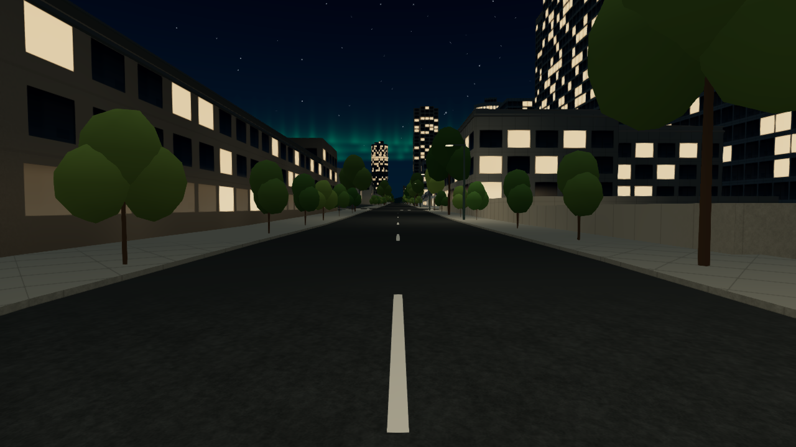
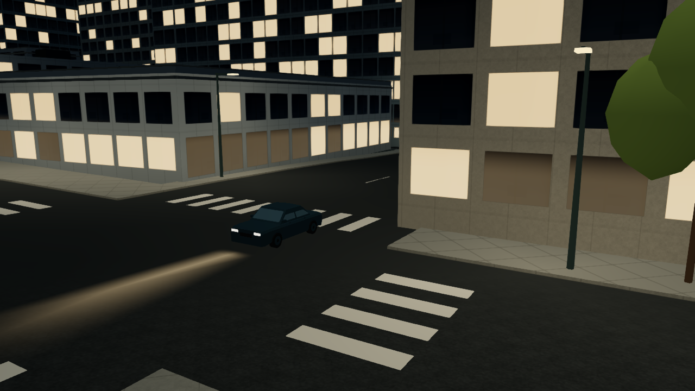
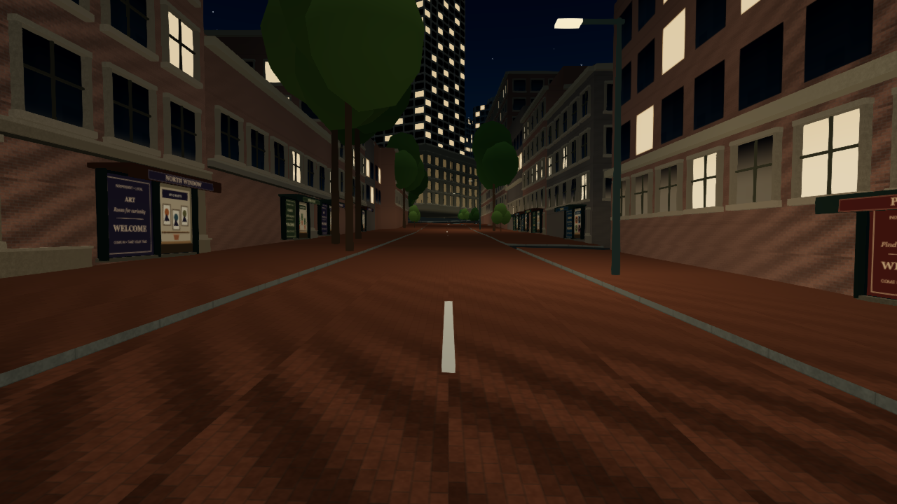
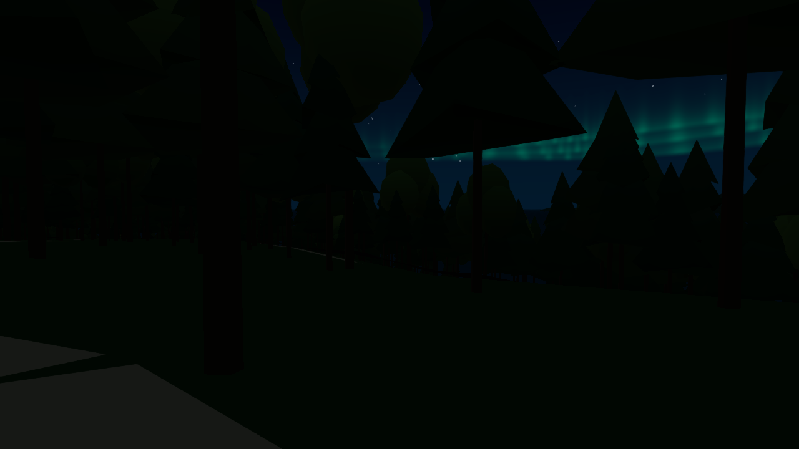

# Downtown night lighting — 2026-10-11

## Behavior and references

**2026-10-23 extension:** the downtown field and its exclusions remain separate.
A new source-local Stanley Park field now lights verified pole surroundings;
see [Stanley Park scenery](STANLEY_PARK_SCENERY_2026_10.md) for inventory, budgets
and retained dark areas. The original validation below describes the October 11
downtown release.

The downtown peninsula now has readable asphalt, sidewalk edges and lower building façades at night. Warm pools sit under the existing procedural street-lamp heads, with darker gaps and upper surfaces. The lamp arms and luminous heads now point toward the roadway. The atmosphere, sky exposure and global ambient intensity retain their previous settings; the geographic receiver mask excludes complete park, wood and water polygons, including their hole semantics, and excludes the outer districts.

The design follows the City of Vancouver's [outdoor lighting strategy](https://vancouver.ca/streets-transportation/outdoor-lighting-strategy.aspx) and [2019 public-realm lighting guidelines, Appendix D](https://council.vancouver.ca/20190723/documents/a4.pdf#page=31), which describe warm street/sidewalk/commercial lighting, generally 3000 K, and avoiding unnecessary light in ecological areas. [City streetscape guidance](https://vancouver.ca/streets-transportation/streetscape-design-guidelines.aspx) distinguishes the character of different downtown districts. [Pechet Studio's Granville installation](https://pechetstudio.com/portfolio/granville-lighting/) and [authored Gastown photographs](https://www.lucasjdiackphoto.com/post/top-photography-spots-in-vancouver-landmarks-and-gear-for-stunning-shots) show readable lower streets and localized sources beneath a dark sky. Granville's unusually bright entertainment street is not used as the brightness target for every block. Photographs can include exposure and wet-pavement effects; the implementation borrows their light hierarchy rather than claiming photometric calibration.

The fixture placement is the atlas's existing procedural placement, not a surveyed fixture inventory. The downtown polygon is an authored display envelope, not an official municipal boundary. Storefront/window activity follows one smooth aggregate daily curve: 21:00 ≈ 0.967, 00:00 ≈ 0.624 and 03:00 ≈ 0.383. This dims lower-pane/frontage glow and modestly dims existing lit city windows after midnight. Road lighting persists. It does not claim real individual business opening hours or switch every business off at 23:00.

## Rendering and resource budget

- One static 512 × 512 RGBA8 field, 1,048,576 bytes, linear filtering, no mipmaps. Roads provide a restrained continuous fill; lamp heads provide warmer local pools. Height and normal attenuation restrict the extra diffuse contribution mainly to street level. This is an approximate shared irradiance field, without dynamic light transport or building occlusion.
- One preparation/upload per scene. Clock changes only update shared uniforms; camera movement and Auto/manual quality changes never rebuild or move the field. Daytime and points outside its bounds skip texture lookup.
- Preserve the existing PBR surface, normal/AO, wheel, façade, batching and instancing hooks. Deferred tree pools and Ultra landmark receivers are prepared before their first draw/warmup. Canceled/disposed materials release their wrapper references immediately.
- NPC traffic gains white head lamps, red tail lamps and a short, soft asphalt footprint. Submitted matrices are the actual vehicle render transforms, including road grade. Imported sedan/SUV lenses, imported buses, fallback buses and fallback car silhouettes have separate matching fixtures.
- At most three instanced lighting draws, no new PointLight, shadow map, per-car texture or per-car material. Nearest lamp pools cap at 64/96/128 vehicles for Balanced/High/Ultra and 40 for compatible graphics. Lamps fade at range boundaries. Asphalt footprints fade from 90 to 120 m and require a finite actual asphalt sample, supplied with the same local height anchor as traffic. Missing road or abrupt grades reject the footprint.

NPC lighting is the scope of this fleet pass. The existing player roadster, parked cabin-owner lighting, independent business signs, moving pedestrian shadows and detailed physical light occlusion have not been individually authored here.

## Validation

The first GPU candidate was too uniformly bright, especially sidewalks and tree canopies. Actual renderer captures led to reduced broad fill (0.40 → 0.16), reduced warm pool strength (0.75 → 0.45), a warmer neutral fill tint, and reduced frontage bounce (0.16 → 0.10).

Final testing uses foreground Chrome 155, normal sandbox/default graphics launch, ANGLE Metal / AMD Radeon Pro 560X, 1280 × 720, DPR 1. Captures are actual renderer screenshots, not synthesized images. Baseline/final pairs use the same explicit viewpoint, quality and hour. Moving traffic, streaming detail and sky animations can differ between captures. The metadata records the parent revision and hash of the actual visual source; it does not pretend that an uncommitted capture is from a final commit.

Automated checks: 1052/1052 repository tests, TypeScript check, architectural contract audit with `--skip-blender`, and changed/new-module lint. Existing diagnostics in `engine.ts`, `environment.ts` and `visual-qa.ts` remain outside the passing lint subset. The asphalt integration regression uses the real GroundSurfaceIndex and rejects missing road samples; the deferred-landmark test covers prewarm, cancel, disposal and reveal without changing the prewarmed material version. Original bus/source asset adoption gates remain intact; no GLB or Blender asset files were changed.

Observed final field preparation: 1530 existing lamp heads, 1314 street segments, 81,249 active texels; 272.9 ms once at initialization on the tested machine. The earlier candidate's 1143.2 ms was reduced by caching geographic mask probes. This measures field construction, not complete scene startup or GPU compilation.

Robson at 23:00 recorded 8 admitted vehicles, 3 accepted asphalt footprints, 70 added triangles and 3 lighting draws. Rawlings Trail had zero field contribution and zero traffic-light draws. At 14:00 the field's night amount and traffic lighting are zero. Actual bus/car pose visitors and fallback alignment are also covered by geometric regressions.

Manual Balanced stationary Robson collected 2400 foreground frames, with 2140 after the first five seconds: approximately 51.5 FPS, median 18.4 ms and p95 28.8 ms on this machine. Earlier baseline timing overlapped development/build activity and is not a controlled A/B benchmark; no speedup is claimed. Automatic-quality travel collected 2400 foreground frames per mode. After excluding the first five seconds, walking averaged 51.4 FPS (p95 24.6 ms), driving 45.5 FPS (p95 25.5 ms), and helicopter cruise 52.3 FPS (p95 22.5 ms). Each remained Balanced in this run. Detailed travel settings, Auto controller state, sample duration and frame-gap counts are in [travel-summaries.json](qa/downtown-night-20261011/travel-summaries.json). These measurements do not guarantee an identical frame rate on other GPUs or devices.

Compatible graphics was also exercised on the actual GPU: downtown lighting and traffic lamps remained valid with the 40-vehicle cap, and Rawlings Trail retained zero field contribution. No page errors or shader-console errors were recorded across the final default and compatible captures. `npm run build:firebase` completed successfully, including protected offline asset/source verification; committed CI/deployment status is available in the associated pull request and GitHub workflows.

## Representative evidence

