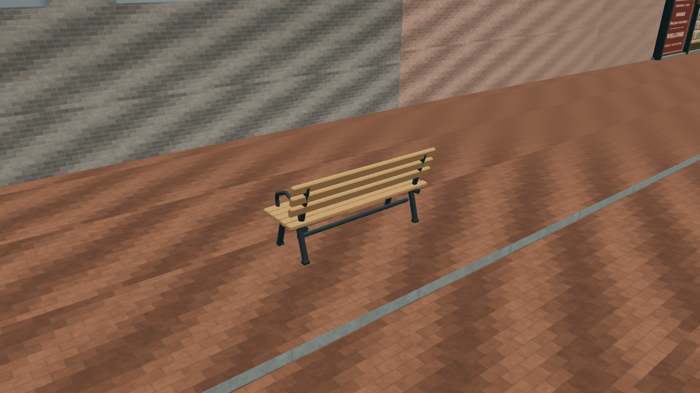
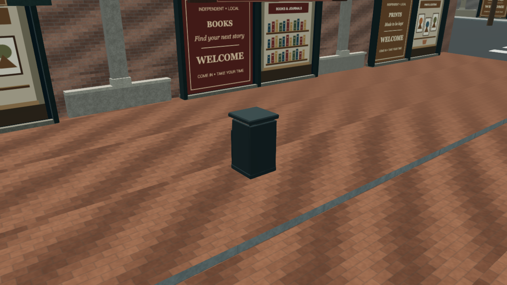
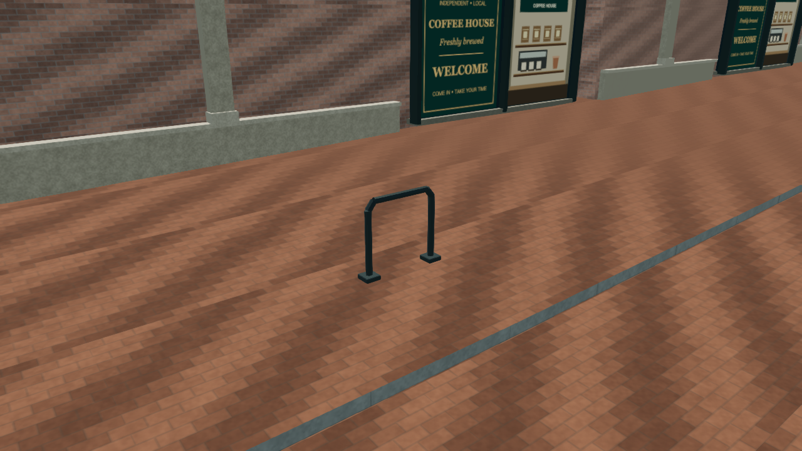
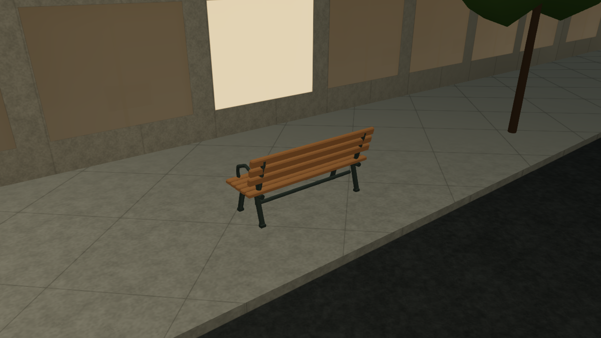

# Downtown street details — 2026-10-17

## Behavior and references

Downtown now uses the existing Blender cedar bench, garbage bin and bicycle rack assets at selected paved street locations. The current city integration accepts 32 placements: 10 benches, 14 bins and 8 bicycle racks. These are representative furnishings derived from source-road geometry and the atlas's rendered footways, not a surveyed inventory or a claim that a particular real-world object occupies each location. No sidewalk is widened to make a furnishing fit.

The placement approach follows the separation of a furnishing/utility strip from a clear walking route in the City's [Accessible Street Design guidance](https://vancouver.ca/files/cov/accessiblestreetdesign.pdf). The [Engineering Design Manual](https://vancouver.ca/files/cov/engineering-design-manual.pdf) also informs the treatment of street furniture, intersections, access and sightlines. The atlas checks its own continuous 1.8 m passage strip behind each furnishing. This is a conservative rule applied to the atlas’s own rendered geometry.

Only actual rendered, ground-level clipped sidewalks and Water Street brick footways authorize placements. Missing paving rejects a candidate; terrain height alone cannot authorize one. The complete source footprint and the walking approach are sampled on those surfaces. Candidates are rejected around junctions and crossings, protected surfaces, building footprints, modeled frontage approaches, existing lamp poles and trees. The footprint must remain within its slope tolerance, and a small separation offset places its ground datum above the highest accepted paving sample. Nearby furnishings remain separated. Stable source IDs retain their identity when road input order or small segmentation details change.

The result adds close street detail rather than a new interaction system. Sitting, placing bicycles in racks, collecting rubbish and other prop interactions are outside this pass.

## Source assets and physical occupancy

The six production GLBs are exact copies of the two existing LODs for `cedar-bench`, `garbage-bin` and `bicycle-rack` in the offline `street-furniture-expansion` package. The [runtime manifest](../public/models/blender/street-furniture/manifest.json) records their source relationship, hashes, sizes, bounds and material bindings. Adoption and build verification compare the production files with the immutable source exports. The source GLBs and editable Blender files are unchanged.

The runtime keeps the original metre scale, +Y up and +Z front convention. It applies each glTF node's world transform once and preserves the indexed triangles, normals, metre-unit UVs, tangents and authored untextured PBR colors and surface response. The bench's asymmetric front/back footprint is retained. There is no loader rotation, nonuniform scaling, new texture binding or geometry simplification.

Conservative oriented ground footprints provide physical occupancy. Player collision becomes active only after the complete renderer is ready and while the Buildings setting is enabled; failed or incomplete downloads do not create invisible player obstacles. Changing quality or LOD does not change the physical footprint. Prospective NPC routes and bus-exit checks reserve planned footprints before the assets become visible, so later admission cannot place a furnishing into a newly selected route or exit. These reservations do not add new NPC or transit gameplay.

## Rendering and resource budget

- Six GLBs total 202,880 bytes. The renderer owns eight fixed geometry/instance batches and two shared authored PBR materials: metal and wood. It adds no textures, dynamic lights, shadow maps or shadow-casting furniture.
- There are at most eight furniture draws, with actor caps of 24/40/64 for Balanced/High/Ultra and 16 for compatible graphics. These are admission caps, not a claim that every frame contains that many objects. The current source population is 32, further limited by distance.
- Both small source LODs remain in the prepared pools for each selected actor. Complementary opaque dithering blends their coverage from 24 to 34 m without transparent sorting or an extra render pass. Keeping both pools populated prevents a fast-moving camera from outrunning CPU LOD selection.
- Outer distance fading uses a 120/140/150 m range for Balanced/High/Ultra, with a 24 m fade band; compatible graphics uses the 120 m range. Newly selected actors fade in over 0.3 seconds. Selection is throttled, and an unchanged actor-ID set produces no repeated instance-matrix uploads.
- Before readiness, network requests and geometry preparation require a nearby street view, motion admission and the engine's shared preparation allowance. Requests run serially, with at most one pending source payload. A failed asset gets at most one retry after a cooldown. Late arrivals and failed preparation release their owned buffers and materials.
- After readiness, travel may select new actor IDs from the already allocated pools, even when motion policy blocks new detail preparation. This only updates bounded instance matrices and admission timestamps; it does not request another GLB or allocate another geometry/material page. It keeps newly approached furnishings visible beside their stable collision footprints.
- Materials join the existing downtown night receiver before their first scene publication. Furniture therefore receives the shared street-light field without another local light. All eight pools are excluded from the SSAO override-normal pass, which cannot reproduce their admission, distance and LOD discard. This avoids AO ghosts from faded or overlapping LODs without adding a pass.

The renderer reports `submittedByLod` and `submittedTriangles`, including geometry subsequently discarded by dithering. Its `triangles` field follows the same submitted-triangle convention as Three's renderer statistics. These numbers are not visible-triangle counts or a GPU residency measurement. The general 64-actor cap would submit at most 61,184 triangles for 64 benches across both LODs; that is a bound, not an observed frame in the current 32-placement city.

## Validation

The consumer regressions cover the six real GLBs, exact source bounds and attributes, authored materials, lazy cold admission, shared preparation budgets, asynchronous disposal, bounded retry, quality caps, stable resource pools, fast travel into prepared actor IDs, night-material hook chaining and live SSAO exclusions. They also move an unchanged actor set across the LOD blend distances without an instance upload and check a fresh admission timestamp after leaving and returning. Placement and world integration checks cover the real-paving requirement, complete footprint and passage probes, obstacles and physical occupancy.

The repository suite passes **1,115/1,115 tests**, with a clean TypeScript check and lint for the four new runtime/QA modules. A follow-up run passes all 18 isolation tests after adding explicit production rejection of furniture diagnostic markers. The architectural contract audit passes all 16 asset/LOD records with `--skip-blender`; this does not rerun editable Blender sources. Existing lint diagnostics in older integration files remain outside the passing new-module subset.

Actual foreground Chrome 155.0.8059.41 used its default sandbox/graphics launch, ANGLE Metal / AMD Radeon Pro 560X, 1280 × 720, DPR 1. The [capture index](qa/downtown-street-details-20261017/capture-index.json) records actual renderer screenshots and metadata, including the parent commit and actual visual-source fingerprint. The captures were taken from the uncommitted stage; their fingerprint distinguishes them from a capture made after the eventual commit. Baseline and final ordinary street views have identical camera, target, viewport, render size, hour and quality. Moving traffic and other asynchronous scenery may differ.

All 32 complete actual-city placement records, including IDs, positions, elevations and headings, remain identical after the ground-index optimization. The [index comparison](qa/downtown-street-details-20261017/index-equivalence.json) records 41 qualified footway meshes narrowed to 6 without changing their triangles or height samples. Observed final construction took 170.6 ms once: 43.1 ms for the floor collection/index, 16.4 ms for exclusions and 111.1 ms for planning. Startup load differs between runs, so this is not a controlled whole-scene speedup claim. Runtime collision probes reject all 32 loaded furniture centers for both player and future-route checks; automated regressions also cover unloaded models, Buildings off/on and disposal.

Actual close-ups check the bench, bin and rack on Water Street, a Robson bench, night illumination and manual High/Ultra. The ordinary daytime/nighttime street, city-distance and Rawlings Trail views retain their expected light field and range behavior. After the default-quality, High/Ultra and travel captures, the furniture retains exactly 8 geometries, 2 materials, 0 textures and 6 successful asset loads, with no retry or failure. Compatible graphics accepts the same 32 placements, shows five nearby actors in both day/night captures and keeps the 16-actor admission cap; its unlit park view has zero furniture draws and zero downtown-field coverage. Default and compatible sessions record no page, shader-console or failed HTTP-response errors.

Three automatic-quality trips each recorded approximately 40 foreground seconds, with the first 5 seconds excluded from timing. Walking covered 160.7 m at 47.3 FPS (p95 27.0 ms); driving covered 545.0 m at 46.0 FPS (p95 27.8 ms); helicopter cruise covered 1,445.4 m at 43.9 FPS (p95 30.6 ms). Camera travel is not vehicle odometry. All three stayed Balanced. No build or test suite ran during these trips. These are whole-scene observations on one machine, not a before/after benchmark or a guarantee for other hardware. Flight still recorded occasional long frames, including a 215.3 ms gap; those samples show no geometry-count increase or detail-preparation work, which is insufficient to identify their cause. This pass does not claim to eliminate existing flight stutter. Full sample counts and gap counts are in [travel-summaries.json](qa/downtown-street-details-20261017/travel-summaries.json).

The [validation summary](qa/downtown-street-details-20261017/validation-summary.json) records resource checkpoints, physical checks, compatible graphics and browser errors. `npm run build:firebase` passes, including all 45 explicitly adopted payloads and the seven furniture files. Production verification rejects all local QA controls and requires the exact accepted furniture, bus, transit and pedestrian payloads. The associated pull request and [validation workflow](https://github.com/YiTaChen/vancouver-living-atlas/actions/workflows/validate.yml) provide committed-source checks; main is published by the [Firebase deployment workflow](https://github.com/YiTaChen/vancouver-living-atlas/actions/workflows/firebase-hosting.yml).

## Representative evidence

[Water Street before](qa/downtown-street-details-20261017/baseline-water-street-14p00h.png) · [Water Street after](qa/downtown-street-details-20261017/final-water-street-14p00h.png) · [Capture metadata](qa/downtown-street-details-20261017/capture-index.json)
