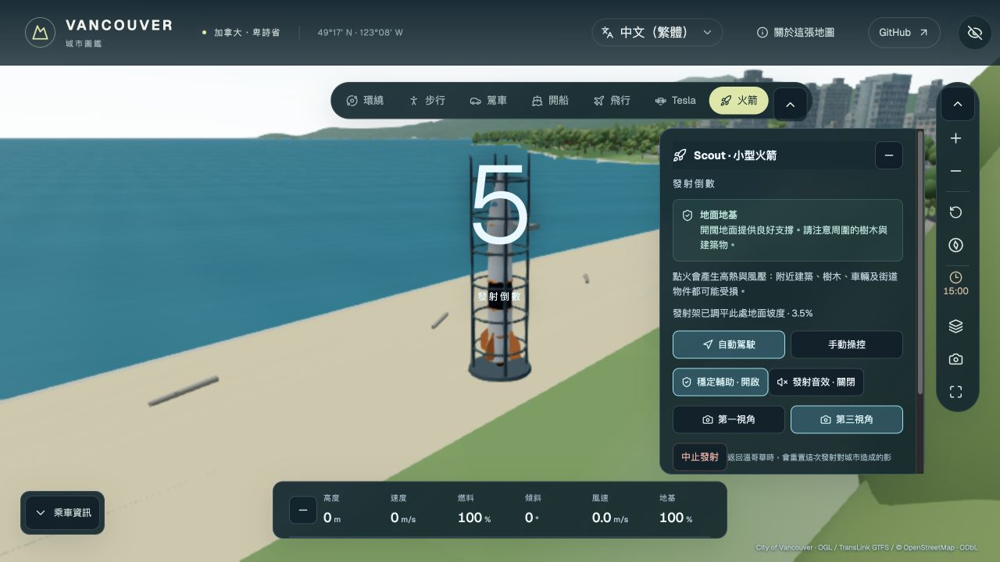
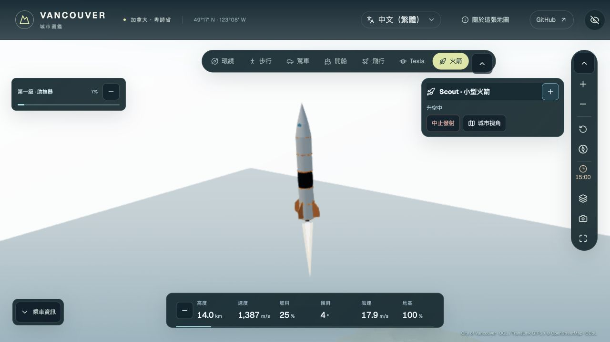
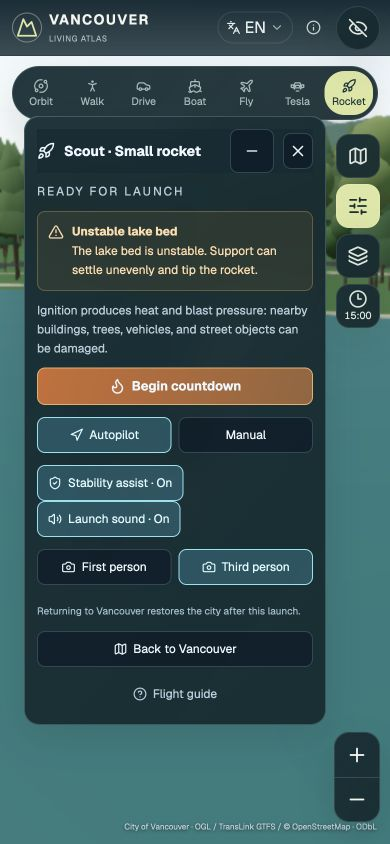
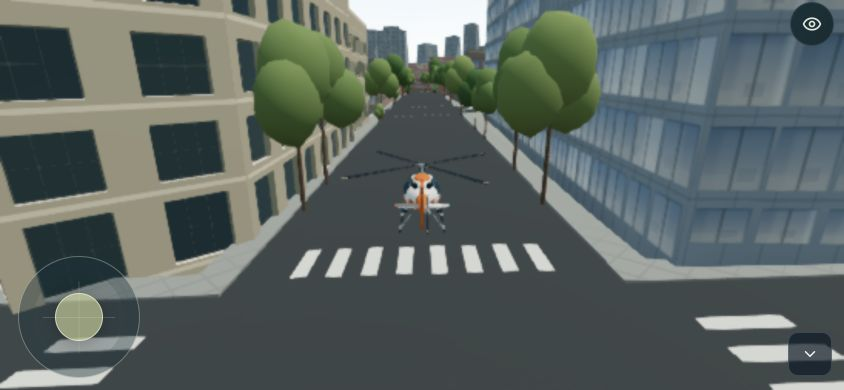

# Collapsible city HUD — 2026-10-23

## User behaviour

The rocket's desktop controls previously occupied the same right-hand strip as
the clock and map tools. Vehicle panels now leave a dedicated tools column:
96 px normally, or 68 px when the tools are collapsed. Desktop rocket controls
also leave space for telemetry below them. Short desktop flight settings sit
beside the map instead of covering it. Camera settings sit below the mode bar.
Mobile portrait panels leave the right-hand actions column free; short landscape
sheets sit below its horizontal actions row.

Use a panel's arrow/minus button to collapse it; its compact title/button restores
it. The following controls have independent disclosures:

- Exploration list, desktop mode bar, tools, map, street controls, camera card,
  placement instructions and journey status.
- Rocket choice, placement, main controls, stage fuel, telemetry, throttle,
  manual attitude and space observations.
- Tesla desktop controls and aircraft cruise/power controls.
- Active public-transport information, discovery routes and Light Lab tasks.

Existing time/layers settings, mobile options sheets and dialogs retain their
close/reopen controls. Vehicle condition retains its native `details` disclosure.
Essential rocket launch/abort/return actions remain available in its compact
main panel. The space panel retains a compact return action.

The eye button now works on desktop and mobile. It hides the interface and map
labels while keeping a recoverable show-interface button. Mobile steering and
essential flight/rocket controls remain available; the aircraft power and rocket
throttle panels can themselves be collapsed. It adds no new keyboard shortcut:
Escape keeps its existing travel/rocket meaning.

## State and input boundaries

`hudHidden` is a visual preference, separate from legacy clean/capture state.
It is not a pause, task reset, new placement, repair, or controller command.
Hiding the HUD no longer disables walking, drift or passenger interaction input.
Opening a settings dialog still uses the existing input/modal gates.

Disclosure keeps content mounted. In particular, the minimap canvas remains the
same engine-owned canvas; its existing zero-size draw guard skips hidden maps.
Discovery/Light Lab visibility is not toggled to implement disclosure, so their
progress and runtimes survive it. Updated telemetry does not reopen a collapsed
panel. Disclosure preferences live in the current page, without a new persistent
storage setting. All ten supported languages include disclosure and restore
labels. Mouse disclosure avoids starting a scene drag or stealing game focus;
Space/Enter activation does not leak into vehicle commands.

## Validation

- TypeScript and local Firebase production build: passed.
- Focused UI/input/task regressions: **95 passed, 0 failed**.
- Scoped lint passed for shared, rocket, flight, Tesla, transit and their focused
  tests. Existing Discovery/Light Lab lint debt is outside this change.
- Native Chrome checks cover 1280×720 and 1280×500 desktop windows, plus
  390×844 portrait and 844×390 landscape layouts. These are desktop-GPU viewport
  checks, not physical-phone performance measurements.
- A normal UI-driven English Bay ground launch was exercised through countdown,
  ignition, ascent and space arrival. The clock opened during ascent, collapsed
  controls stayed collapsed, and altitude continued from about 14 km to 70 km
  while the global HUD was hidden.
- A recovery-layout capture uses the existing lake-support failure path; it is
  separate from the successful ground launch. No rocket physics is changed.
- Time-button centre hit tests passed on desktop and both mobile orientations.
  Landscape aircraft time, zoom and disclosure hit tests also passed.
- The final production build also passed native walk/flight placement disclosure,
  camera-card spacing, hide/restore and an empty browser error-console check.
- The full repository suite and production-build verifier run in PR CI before
  merging. Production output must retain the existing QA exclusion and CSP gates.

Native evidence and capture hashes are in
[`qa/hud-panels-20261023/`](qa/hud-panels-20261023/).

