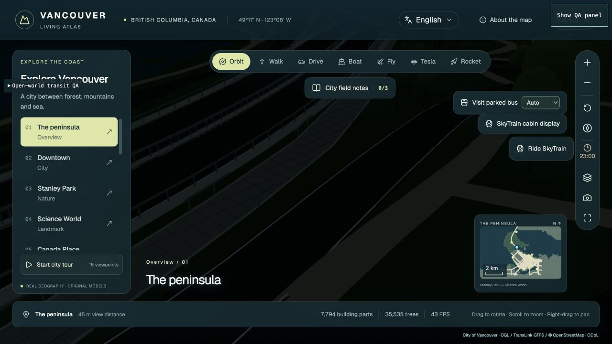
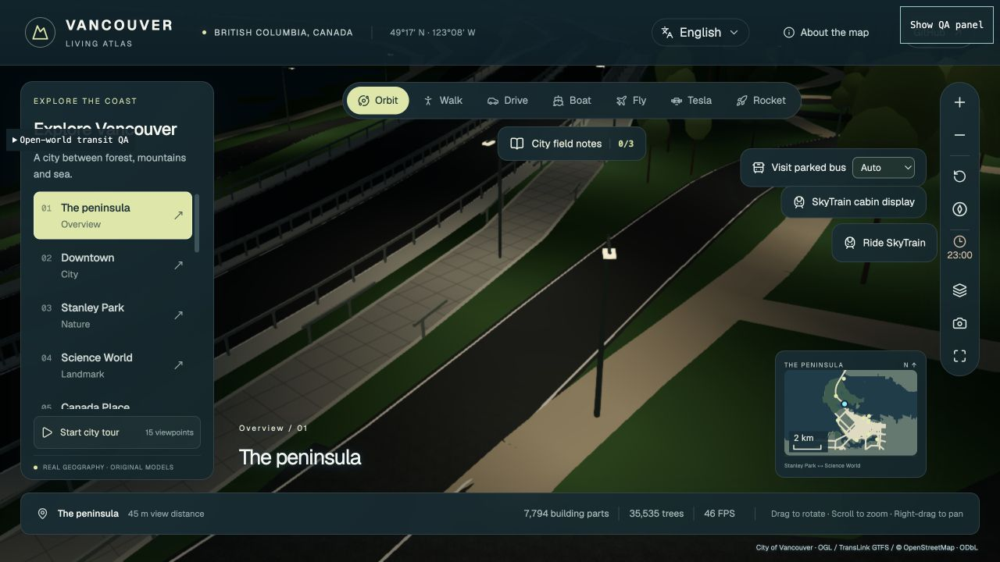
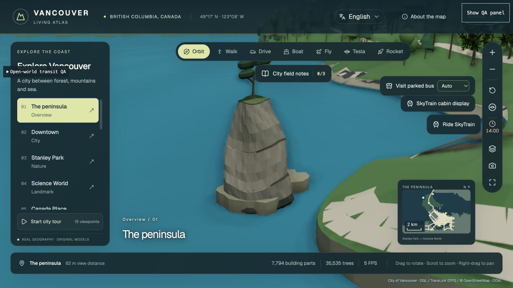
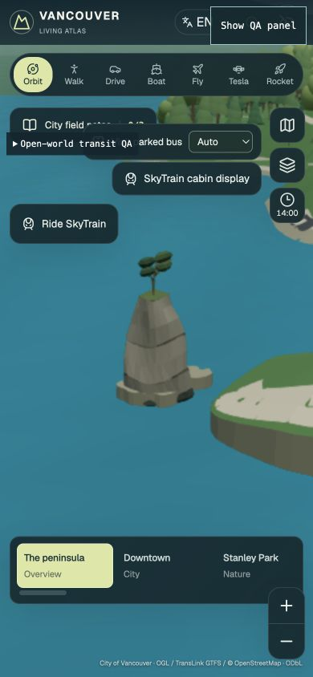

# Stanley Park scenery — 2026-10-23

## Scope and order

This pass follows the earlier downtown lighting, bounded furniture, and protected
landmark PRs. It improves one coherent area without broadly enabling unaccepted
Ultra tree/Blender candidates or changing the sky exposure.

1. Replace procedural lamps **inside Stanley Park** with a reproducible municipal
   pole inventory, then give nearby ground a finite warm light pool.
2. Replace Siwash Rock’s three primitive shapes with an original, opaque,
   distance-adaptive rock and windswept tree, and correct its misplaced anchor.
3. Restore the existing urban facade night hook for the current GIS v4 shader.
4. Validate at fixed day/night views, exercise desktop/mobile layouts and Auto,
   then merge and deploy the tested tree.

This is not a claim to have rebuilt the entire city or surveyed every park light.
Brockton Point Lighthouse and Prospect Point remain candidates for a subsequent
source-backed landmark pass. Their approach, ground levels, and public routes
need their own acceptance rather than a decorative object placed arbitrarily.

## Source-backed park lighting

The [City’s Engineering Services street-lighting pole inventory](https://opendata.vancouver.ca/explore/dataset/street-lighting-poles/)
provides positions, not bulb power, fixture type, opening hours, or live operating
state. The regional snapshot has 778 records; an exact intersection with the
existing Stanley Park polygon (including holes) selects **103 source records**.
Two observations less than one metre apart share one representative fixture,
resulting in **102 deduplicated inventory positions**, with all original IDs
retained. The actual runtime land test admits **101 visible/collidable fixtures**.
S2:26 falls about 2.9 m outside the generalized coast and is retained as a
rejected source record, without a floating pole, light pool or invisible collider.
The export, metadata, retrieval time, SHA-256 hashes, license and limitations are in
`tools/sources/stanley-lighting/receipt.json`. Reproduce the bundled runtime subset
with `node tools/generate-stanley-lighting-source.mjs`; it uses retained offline
source bytes and rejects a changed park boundary/hash.

Only in-park procedural fixtures are replaced. Each physical fixture shares one
published index across its pole, luminous head, impact collider and light-source
mapping. The representative pole shape, road-facing arm, warm colour and falloff
are authored approximations. Outside-park lamp poses/order stay unchanged.
Inventory absence does **not** prove that a Park Board/private lamp is absent.

The new independent 512 × 512 RGBA8 field costs **1 MiB GPU texture storage**.
It contains source-local pools, with zero continuous street-fill channel. It is
separate from the existing 1 MiB downtown field. Retained park CPU state is
1,050,192 bytes (one float field plus source coordinates), in addition to
transient preparation buffers and the uploaded byte field. A single shader owner
installs two samplers with one shared world-position varying, preserving original PBR,
instancing, facade, cutaway and disposal hooks. No new PointLight, shadow map,
per-pole material or lighting draw is created. Daytime/out-of-field branches
skip the lookup; clock and quality changes update uniforms, not geometry/fields.
The extra sampler and receiver shader instructions are real GPU costs; this is
not a zero-cost effect or a measured frame-rate improvement.

Roads and terrain around validated sources can now receive light. Terrain uses
a park-only wrapper so the old downtown terrain response remains unchanged.
The existing park/land/water mask clips pools conservatively. The unsupported
S2:26 base is excluded before publishing the common render/impact/source array. Its original position and rejection reason remain
documented; excluded water is not brightened to conceal a geographic mismatch.
Rawlings Trail, unverified interior trails and Beaver Lake remain dark. This follows the
[City’s outdoor lighting strategy](https://vancouver.ca/streets-transportation/outdoor-lighting-strategy.aspx)
for localized useful light and reduced ecological spill, without imposing a
new gameplay curfew.

A broken lamp removes its own finite warm pool while preserving overlapping
working lamps. Stable global-to-field indices prevent a park impact from turning
off a downtown source. Runtime source state and both fields are disposed together.

## Siwash Rock

The previous landmark was two cylinders plus a nine-metre tree cone. The new
original mesh adds an asymmetric fractured profile, intertidal ledge, mossy
shoulder, short exposed trunk and broad, irregular wind-shaped crown. It uses
vertex colours and one opaque mesh/material at each active level (one colour
draw; existing shadow/depth passes can draw it too): **488 / 1,200 /
3,168 triangles** for low/medium/high. There are no texture downloads, alpha leaf
cards, local lights or worker jobs. All three small levels are prebuilt once;
quality and distance select one level with 18% hysteresis. Balanced already uses
medium nearby; High uses high nearby; Auto follows its effective quality.

Visual/geographic references are the [City’s landmark page and photograph](https://vancouver.ca/parks-recreation-culture/landmarks-in-stanley-park.aspx),
the [MineralsEd/GSC geotour, stop 4](https://mineralsed.ca/site/assets/files/3451/stanleyparkgeotour2011web_me.pdf),
and [BC Geographical Names](https://apps.gov.bc.ca/pub/bcgnws/names/21433.html).
This is a silhouette-based interpretation, not a photogrammetric or geological
survey. No photograph pixels or cultural artwork are shipped.

BC identifies the **approximate** centre as 49°18′31″N, 123°09′21″W. The old atlas
anchor was roughly 450 m southwest and far from its mapped lookout. Native QA
then exposed two pre-existing tiny rock islands in the reconciled coastline:
the larger 107.88 m² island agrees with Siwash’s position. The final anchor uses
that source island’s centroid, **−123.1560181124, 49.3087515252**. The model’s
horizontal footprint is scaled to the source island while retaining its vertical
silhouette. This is an authored fit to the existing generalized coast, not a
surveyed three-dimensional reconstruction.

A related old rendering defect emitted independent nine-metre-wide shoreline
quads around the tiny closed rings, producing radial spikes larger than the
islands. The bounded repair uses the existing closed source rings for compact
rock caps. A further 30 mainland segments around Siwash use vertical rock faces
at the exact source edge, removing the old outward-expanded spokes. The other 4,387
segments retain their existing position and normal bytes. The old decorative
quads added artificial walkable floor over water; the new vertical faces add
zero offshore floor area. Existing land masks, path floors and bridge volumes
remain authoritative.
The coastline source, bridge water footprints, road graph, route legality and
navigation data are unchanged. The existing rock island remains the physical
land footprint. Maximum model height is 24.3 m, within the former 26.5 m envelope.

## Urban facade correction

The night receiver detector expected the old `atlas-city-bodies-pbr-v2` cache key,
while real GIS building bodies use v4. Recognizing the current shader restores
its existing lower-pane/frontage activity hook. The material’s original shader,
program identity and occlusion wrapper are retained; new building/window assets
or real business opening hours are outside this patch.

## Validation and evidence

- TypeScript check: passed on the integrated `ea76bc5` main baseline.
- 90 focused tests passed: source admission, actual runtime land/water masks,
  default 512² pools, impact indices, shader composition in both occlusion orders,
  real GIS v4 material, deferred receiver disposal, all Siwash LODs, actual
  landmark/harbour/bridge integration, local shore parity, and deployment isolation.
- Strict scoped lint passed for the new modules, verifier and isolation tests.
  Existing lint debt in large legacy modules and the old harbour harness is not
  presented as fixed. The harbour fixture now supplies the actual renderer/quality
  contract required by the added landmark owner.
- `npm run build:firebase` passed, including immutable asset/source adoption,
  deployment isolation and the nine exact CSP hydration hashes. The whole updated
  repository suite is also required in PR CI before merge; CI records the final
  integrated count separately from the local focused run.
- Independent final source review found no blocking issue.

Actual native renderer captures cover Second Beach, Georgia entrance, Avison,
and the supported Lumberman pole at 23:00. Georgia is also checked at 03:00 and
14:00. Its fixed camera, target, hour and quality match the baseline exactly.
Rawlings and Beaver Lake have zero local park field coverage. The daytime night
amount is zero even though the immutable baked texture remains resident.
Robson retains its existing roadway light while the restored GIS lower-pane
hook is visible. Console error captures are empty.

At the native checkpoints, the park field reports 101 lamp sources, zero road
sources and 16,580 active texels. Both GPU fields stay at 2,097,152 bytes total.
Balanced/manual selects Siwash medium nearby, High/Ultra select high, Auto follows
its effective Balanced level, and native zoom-out switches to low. The fields
are retained rather than rebuilt during these changes. The mobile test uses
Chrome’s **390 × 844** viewport and ordinary zoom buttons; this is a layout and
renderer check on a desktop GPU, not a physical phone performance benchmark.
No controlled FPS speedup is claimed.

[Lighting source receipt](qa/stanley-scenery-20261023/lighting-source-receipt.json)
identifies the accepted lighting tree. A subsequent local mainland-shore repair
changes only the Siwash coastal sector; lighting and source-admission module
bytes are identical in the final tree. The [final source receipt](qa/stanley-scenery-20261023/final-source-receipt.json)
identifies final Siwash/mobile captures, and [capture inventory](qa/stanley-scenery-20261023/capture-inventory.json)
records screenshot sizes/hashes. The Siwash before/after views use the old and
corrected anchors respectively and different viewing directions; they are
qualitative model/geography evidence, not a matched pixel or FPS comparison.

Local QA controls are stripped from normal builds and explicitly rejected by
Firebase’s verifier. Labels and standalone leaked module filenames are both
tested. No QA menu becomes a public interaction flow.

