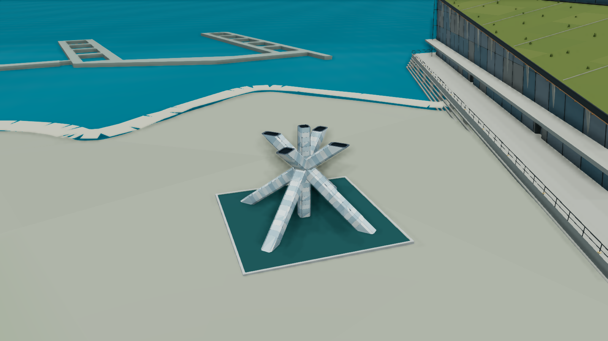

# 海濱景觀細化 · 2026-10-22

這輪聚焦 Jack Poole Plaza 與 Coal Harbour marina，從 `bb26294` 延續城市場景；不包含另一分支的火箭功能。

## Jack Poole Plaza

- 新增原創奧運聖火台：四根交錯斜臂、中央晶體、五個未點火杯口、玻璃分面與金屬接縫。官方高度 10 m、工程師公布整體寬約 12 m；臂端、截面細節及朝向按照片近似，並非測繪或工程模型。
- 座標取自 OSM node `648735254` version 7：`[-123.1176596, 49.2893606]`。水池沿用 OSM way `1070091596` 輪廓；來源快照、ODbL attribution 與界線保存在 `lib/city/waterfront-source.json`。
- 基座使用城市實際渲染地面的中心、四角與四邊中點，共九個取樣。缺少地面、非有限高度或坡差超過 1.25 m 時，不生成浮空地標。
- 接管 Nature 原本的同一水池，更新顯示水面與水面 registry 高度，隱藏舊水面但保留資源所有權。不疊加兩層水、不新增可航行湖泊。
- 水池阻擋步行與起點放置；飛行碰撞使用聖火台與池緣的實際三角形。水面保持 terrain layer，雕像與池緣跟隨 Buildings layer。
- 聖火台為 3 個 opaque batches、4,032 triangles；池緣與替代水面另 2 個 batches。沒有新貼圖、外部模型、即時反射 pass、點光源或執行中下載。
- 可編輯 Blender 來源與重現工具在 `tools/assets/olympic-cauldron/`，使用同一份 runtime mesh，而非另一個未接入的展示模型。`.blend` 不進入部署資產。

## Coal Harbour marina

- 依現有 mooring → marina → pier 關聯，限定 5 條 pier source：`105690047`、`105690052`、`105690059`、`105690060`、`105690064`，共 45 段。
- 業者資料明示 cement floats；新增混凝土模塊接縫、側邊護舷色帶與 20 個低矮繫船件。細節為原創視覺近似，並非實測設備配置。
- 全部 390 個碼頭碰撞輪廓與原版逐值一致，頂面仍為 Y=1.6 m；未新增船隻或改變船舶路線。
- 全碼頭 6,976 → 9,424 triangles（+2,448），1 → 2 draws。這是幾何成本，不代表整城 FPS 提升。

## 檢查與重現

```sh
npm run check
node --test tests/waterfront.test.mjs tests/olympic-cauldron.test.mjs tests/harbour-docks.test.mjs tests/harbour.test.mjs
npm test
npm run build:firebase

# 本機視覺驗收；instrumented build 不部署
VANCOUVER_STATIC_EXPORT=1 VANCOUVER_VISUAL_QA=1 npm run build
node tools/serve-visual-qa.mjs waterfront-oct22
```

QA cases：`jack-poole-plaza`、`coal-harbour-docks`；`Waterfront before/after` 在同一相機切換外觀，`Waterfront proof` 顯示地面、來源與碰撞資料。Before/after 是視覺比較，並未切換整套導航狀態。

新增測試涵蓋主體尺寸／法線／資源釋放、地面失敗回退、單一水池替換與高度同步、步行排除、實際飛行三角形、碼頭來源範圍與逐值相同的碰撞輪廓。

## 參考資料

- [Vancouver Convention Centre · Olympic Legacy](https://www.vancouverconventioncentre.com/about-us/our-story/olympic-legacy)：永久地標、10 m 高與實景照片。
- [Glotman Simpson · Olympic Cauldron](https://glotmansimpson.com/project/olympic-cauldron-at-vancouver-convention-centre/)：10 m 高、12 m 寬、鋼／polycarbonate／glass，以及每臂 16.5 × 1.2 m 的結構描述；16.5 m 未當作模型的可見地上臂長。
- [Convention Centre · Outdoor Plazas Guidelines](https://www.vancouverconventioncentre.com/fullpdf/outdoor-plaza-guidelines)：Jack Poole Plaza 配置與使用範圍。
- [OSM cauldron node](https://www.openstreetmap.org/node/648735254)、[reflecting pool](https://www.openstreetmap.org/way/1070091596)：地理位置與輪廓。
- [Coal Harbour Marina · Annual Moorage](https://coalharbourmarina.com/annual-moorage/)：混凝土浮台材質依據。

官方照片僅供觀察，沒有作為材質或貼圖打包。

## 本輪驗收紀錄

- TypeScript、限定修改檔 lint 與 `npm run build:firebase` 通過；後者僅打包與驗證，沒有部署。
- 完整 `npm test` 執行 1,904 項：1,903 項首輪通過。唯一失敗的離線材質來源保護檢查，在碼頭來源遷移後以同一父測項定向重跑通過；其內含 16 項單元測試及 consumer／furniture validators。另重跑本輪城市／港灣／飛行 32 項，32/32 通過。沒有把原 baseline hash 改成新 runtime，也未宣稱最後版本再次完整執行整套 1,904 項。
- 舊材質 fixture 在本機 Node 24.22.1 有一個 `1.7763568394002505e-15 m` 的既存浮點差異；以 memory-only 還原原 HEAD 後仍可重現。例外只限單一 Science World polygon 座標、≤1e-12 m，其餘幾何／順序／metadata／雜湊維持嚴格比對。詳見 [證明及限制](../tools/assets/material-consumer-candidates/qa/fixture-portability.md)。新增反向測試防止例外擴大。
- Blender 重新開啟 `.blend`，三份 mesh 的頂點及顏色與 runtime Float32 逐位元一致；source manifest 保留完整指紋。
- 本機真實 WebGL 擷取為 1600×900、High，固定相機與14:00／23:00；另有 `coal-harbour-dock-detail` 近景。畫面擷取時其他 CPU 驗收仍在執行，這些檔案用於視覺檢查，不作 FPS benchmark。
- 開發模式重載時曾記錄 Three `compileAsync/isReady` 錯誤；後續使用靜態建置驗收，沒有再新增該錯誤。本輪沒有宣稱已修復開發模式 shader readiness 問題。

| 場景 | 原始外觀 | 本輪外觀 |
| --- | --- | --- |
| Jack Poole Plaza | [Before](visual-quality/waterfront-oct22/plaza-before.png) | [After](visual-quality/waterfront-oct22/plaza-after.png) |
| Coal Harbour marina | [Before](visual-quality/waterfront-oct22/docks-before.png) | [After](visual-quality/waterfront-oct22/docks-after.png) |

[碼頭近景](visual-quality/waterfront-oct22/docks-detail.png) · [未點火夜景](visual-quality/waterfront-oct22/plaza-night.png)。After JSON 保留相機、時間、品質、來源指紋與地面高度。Before/after 保持相機，城市動畫時間繼續前進。


