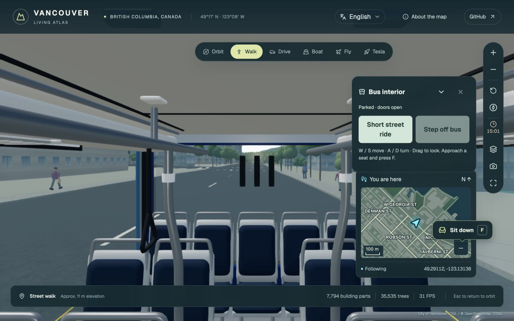
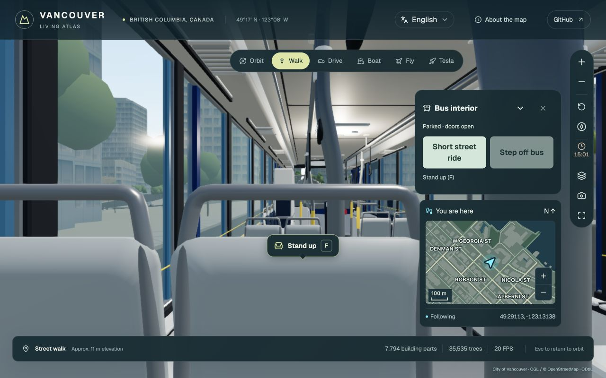
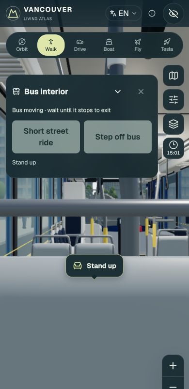
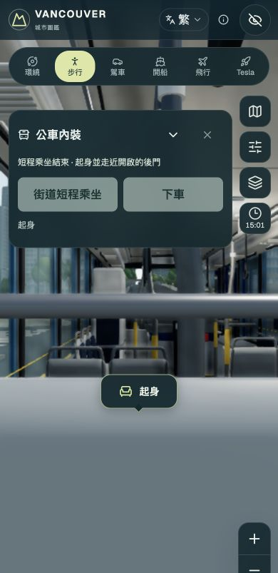
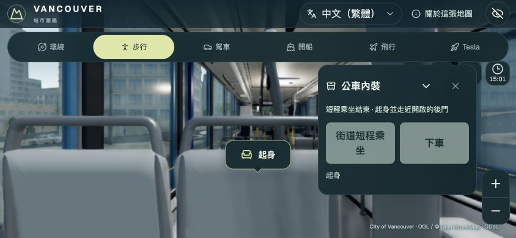

# 公車實體座位驗收 · 2026-10-22

整合基準 `bb26294`，保留新版 TransLink hybrid 外觀、無障礙坡板與正式 CSP 貼圖解碼。人物從實際走道上車，接近座椅後以 F／手機點提示坐下與起身；坐著與站在走道都附著於公車當下座標。

## 自動驗證

- 107／107 針對性測試、TypeScript、變更核心與 UI 的 type-aware deny-warnings lint 通過。
- 正式 Firebase 建置及現有模型／來源契約驗證通過；沒有修改公車 GLB、CSP 或歷史素材基準。
- 三種內裝的碰撞 BVH 經獨立完整三角形方式比對共 9,000 次，結果一致。CPU 效能收據與最終來源 SHA-256 位於 `automated-verification.json`；數字不是手機硬體或整體 FPS 保證。
- 完整 repo CI、合併與部署結果以本次 PR／Actions 的最終版本為準。

## 原生瀏覽器

最終正式建置，使用實際 CSP，從公開上車按鈕操作；沒有注入人物、座位或車輛狀態。Auto 實際採用 reference-lod1，無降級。1280×800 桌機、390×844 手機直向、844×390 手機橫向通過。這是手機尺寸瀏覽器驗收，不是實體手機硬體測試。

已操作：實際走道／後排階梯、F 坐下、行駛中保持座位、手機點按行駛中起身、搖桿轉向與走動、手機點按坐下、英文與繁中切換、橫向提示未被面板遮擋，以及停妥後走近開啟的後門下車。主控台沒有錯誤。所有十語系的提示與按鈕 handler 另有自動化測試。

## 目前範圍

街道短程乘坐使用同一已驗證路段，6–60m，平順加減速，關門出發、停妥開門；並非定時 TransLink 公車路網。坡板未收妥不能出發；行駛中不能下車或強制切換模式。車內品質須下車後調整；整體畫質 Auto／手動設定保留。
