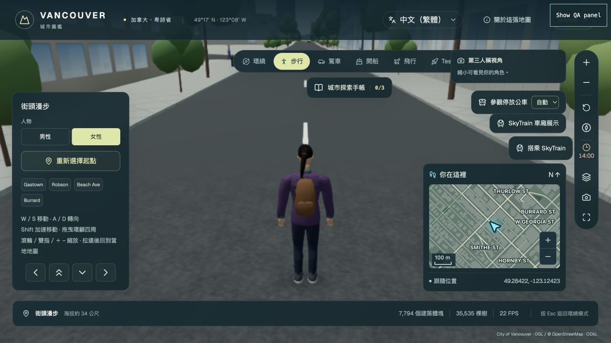
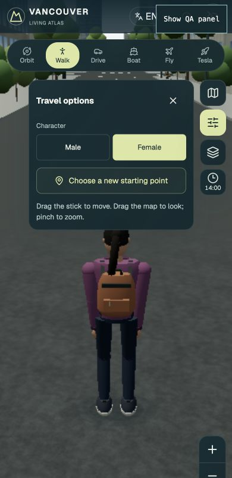

# Selectable walking characters — October 22, 2026

Adds a female character alongside the original male character. The female uses
the project's original rig and PBR atlas, with an adjusted silhouette, a plum
rain shell and tied hair attached to the head bone. The compatible renderer has
a matching procedural variant. No additional model download is required.

In **Walk**, use **Character → Male / Female** in the left walking controls,
or **Travel options** on mobile. The selection remains in the current page
session when changing travel modes. Scroll or pinch out to see the character.
Labels are translated in all ten interface languages.

## Browser acceptance

- Actual desktop city, full renderer, 1280 × 720: female selected, third-person
  model rendered, both buttons unobstructed in the left panel.
- Switching male → female retained the displayed coordinates and the camera
  distance of **4.26 m**. Drive → Walk retained the female selection.
- Compatible renderer, 390 × 844: mobile Travel options exposes both buttons;
  male → female works, selected state updates, both buttons are **44 px** high.
- Desktop 1280 × 540: walking panel spans y=120–430 and scrolls; character
  buttons remain visible at y=196–232.
- Traditional Chinese labels were checked in the running desktop city.
- An isolated development scene loaded the actual two GLB appearances and
  confirmed front views and seated side views, including hair following the
  head. This scene is an ignored local inspection harness.

These are browser viewport checks, not a physical-phone performance result.

## Automated validation

- TypeScript check passed.
- Focused character, loading/lifecycle, seating and locale suites: **30/30**.
- Scoped character implementation lint passed; no new page lint diagnostics.
- Production `npm run build:firebase` passed after the final runtime/UI changes,
  including asset, locale, worker, adoption and generated CSP verification.
- On the initial feature base `a7cf21c`, the full regression run passed
  **1,840 of 1,841** tests. Its sole failure was
  the material-consumer audit's historical navigation hash, which correctly
  rejected the newly added selector API. The audit now subtracts only the exact
  reviewed character additions before applying its unchanged historical hashes;
  negative tests continue rejecting altered selectors and unrelated navigation.
  The affected package-contract test passed after that update, along with all
  **13/13** audit unit/negative tests, **11** consumer checks and **58 × 2 LOD**
  furniture placements. All 30 historical audit QA files remained byte-identical.
- After synchronizing main `6c4b6ce` (TransLink hybrid bus and detailed Roadster),
  TypeScript, the **30/30** focused tests and the production Firebase build were
  rerun and passed again.

Character regressions cover the actual skin, exact male geometry/normal
restoration, protected skin colors, loading-time selection, failure fallback,
stable roots/contact shadows, gait blend and phase, seated floor contact and
owned resource disposal. No deployment was performed by these checks.
