# 火箭遊戲：實際畫面與驗收

2026-10-22，分支 `codex/rocket-launch-game`。以下是執行中的 Three.js / WebGL 畫面，不是生成圖片。

本輪 Titan 改成明亮銀色箭體、清楚的黑色隔熱面與銀框翼片，並加入四枚真正會先分離的外掛助推器。四枚外掛與中央核心同時點火，側助推器先釋放、核心持續推進，最後再分離核心並由上面級飛往太空。地面五股噴流會撞擊實際表面、向外攤開並隨噴嘴高度淡出。[城市驗收 18／18](titan-four-runtime-report.json)、[模型展示 4／4](titan-four-model-report.json)與[完整回歸 2,016／2,016](titan-four-test-summary.json)通過；完整套件含 121 項火箭測試及其中 19 項 UI 測試，TypeScript、lint／格式檢查和 `build:firebase` 通過，沒有部署。[四助推器流程與獨立驗收](TITAN_FOUR_BOOSTERS.md)整理本輪證據。

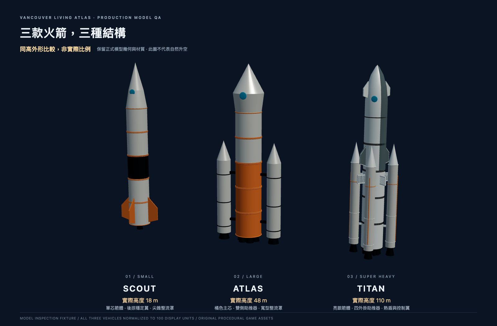

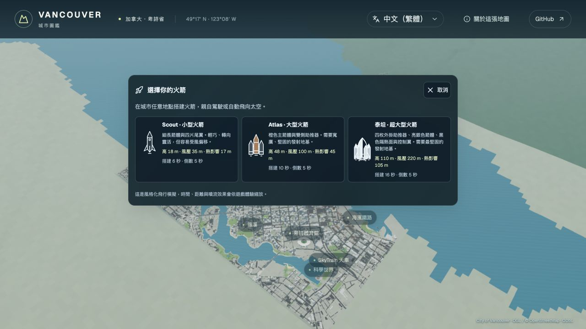

先前三型首次加入時，完整回歸 **2,001／2,001 通過**，包含 106 項火箭測試及其中 17 項 UI 測試，當時 TypeScript 與 `build:firebase` 通過；[舊版測試摘要](titan-test-summary.json)、[12 項城市 runtime](titan-runtime-report.json)及[4 項模型 gallery](model-gallery-report.json)分開保留。這些結果與下方舊圖沒有改寫為新版四助推器驗收。

載入緩衝時間保留：Scout 小型建造 6 秒、Atlas 大型建造 10 秒、新增 Titan 建造 16 秒，三型倒數均為 5 秒。先前報告與圖片中的絕對 elapsed 是恢復緩衝時間前那次驗收紀錄，沒有改寫為新時間。

先前漸進屋頂坍塌、箭體火災、真實機身破裂與事故後觀察已通過 **13／13 項事故 runtime 驗收**，另有當時的 14 項 UI 元件測試。下方原有 21／21 結果與截圖保留為先前兩級環境驗收；兩組報告分開，沒有覆寫或混算，也不代表新增 Titan 的城市驗收。

## 三款外形與 Titan 超大型火箭

| 機型               | 外形與可見部件                                                                | 尺度及影響                             |
| ------------------ | ----------------------------------------------------------------------------- | -------------------------------------- |
| Scout 小型         | 細長箭體、4 片後掠尾翼、單主引擎                                              | 高 18 m；風壓半徑 35 m、熱影響 17 m    |
| Atlas 大型         | 橙色核心、白色整流罩、2 枚白色側助推器、7 個主引擎                            | 高 48 m；風壓半徑 100 m、熱影響 45 m   |
| Titan 泰坦・超大型 | 明亮銀色鼻錐、黑色隔熱面、4 枚外掛助推器、4 片控制翼、4 片格柵翼、19 個主引擎 | 高 110 m；風壓半徑 220 m、熱影響 105 m |

三型使用不同幾何與材料，選擇卡也有不同 SVG 剪影。翼片、側助推器、隔熱面和噴嘴隨箭體節段搭建、分離與破裂，不是同一枚火箭換尺寸。Titan 的格柵格線合併繪製，控制物件與粒子也採專用上限。

Titan 需要更寬廣、堅固的地面或平台；箭體半徑 6.3 m，包含四枚外掛與翼片的完整碰撞包絡半徑更新為 14.1 m，上面級為 10.1 m。近地效果強度更新為 2.2，不再將 220 m／105 m 的半徑乘大；範圍是遊戲影響區，實際受損仍受方向、距離、高度及有上限的物件池影響。一般屋頂、湖床、弱地基與海河仍有原本的失效或下沉風險。

詳細參數、三型對照及效能上限見 [Titan 規格與預算](SUPER_HEAVY.md)。外形只參考 NASA SLS 與 SpaceX Starship 的可辨認語彙，三款都是原創遊戲載具，並非真實火箭藍圖。

## 新版 Titan 四助推器、五股地面噴流與分離

初始 HUD 顯示「四側助推器＋核心」，核心與外掛燃料一開始就同時消耗。側助推器釋放的 0.8 秒顯示真實動畫進度與「核心持續推進」；核心剩餘燃料不會重新填滿，手動推力、姿態與中止仍可操作。再經核心燃盡分離、上面級點火，完成太空任務。

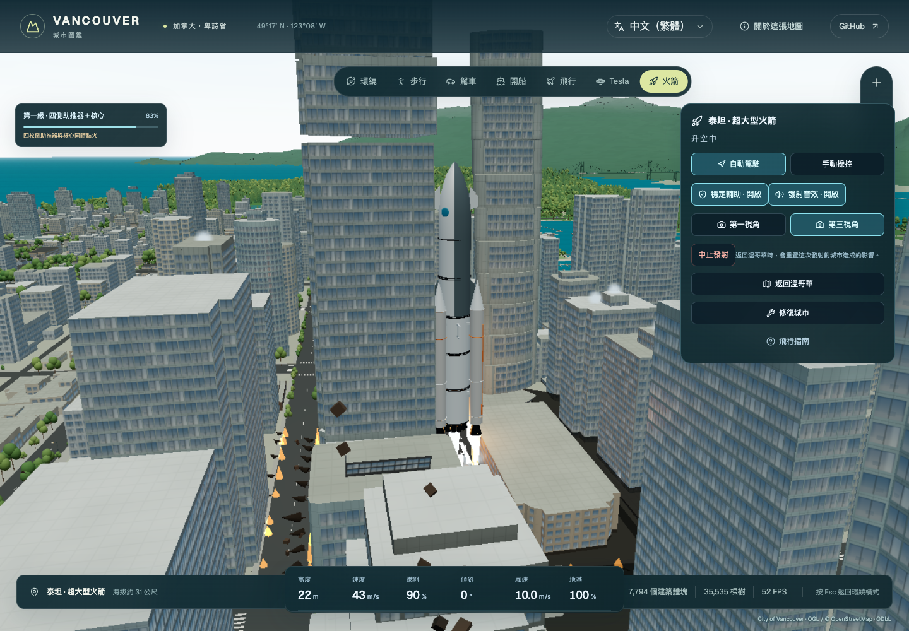

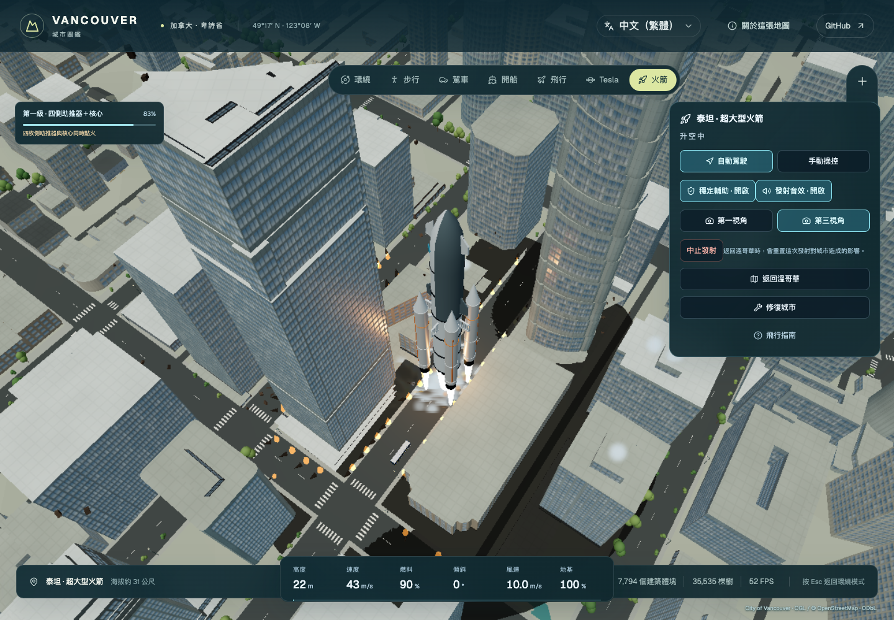

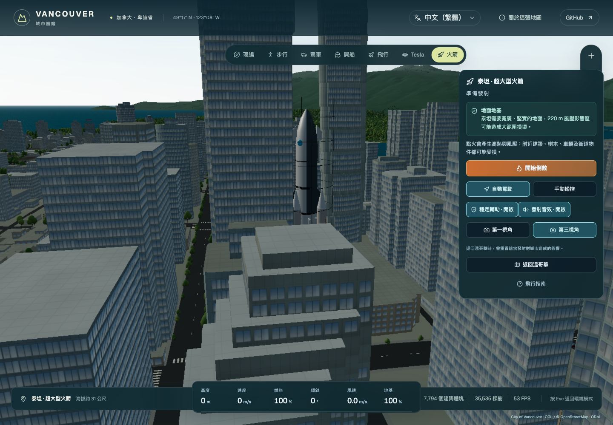

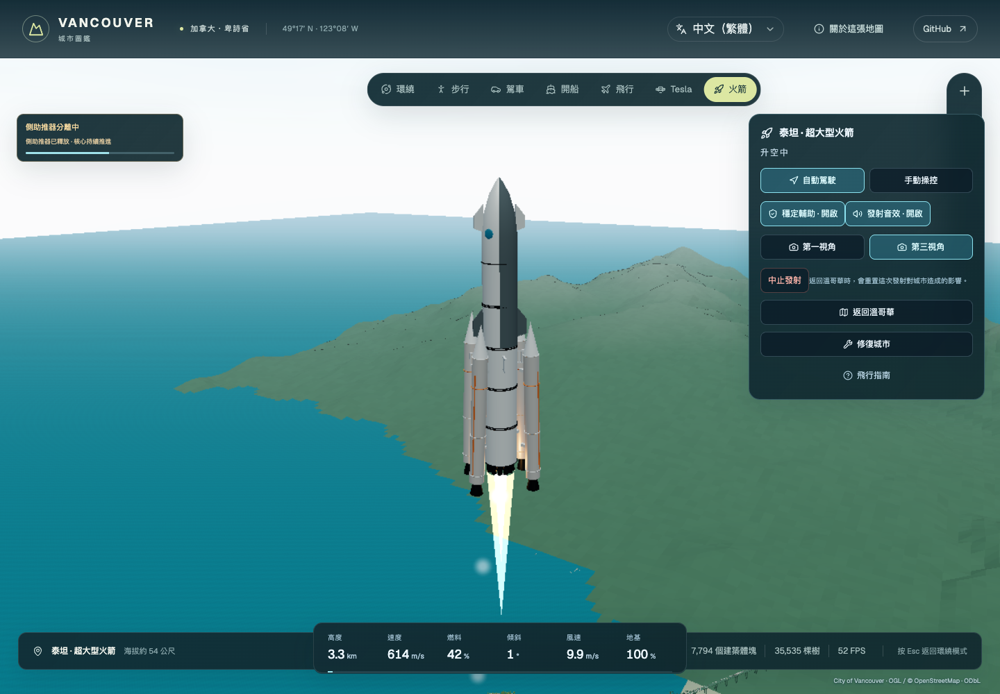

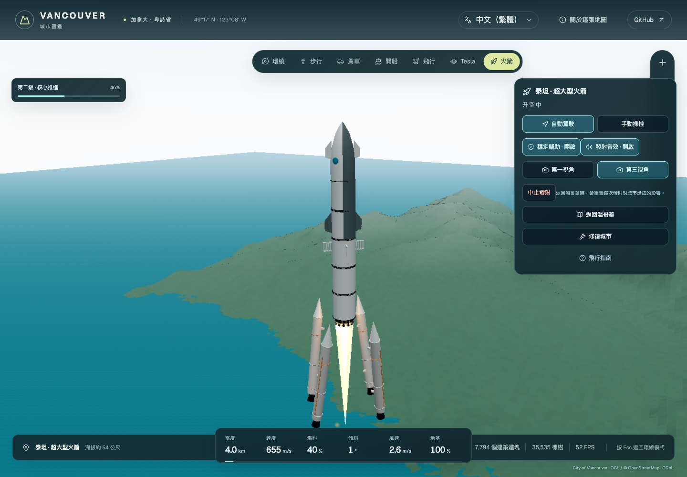

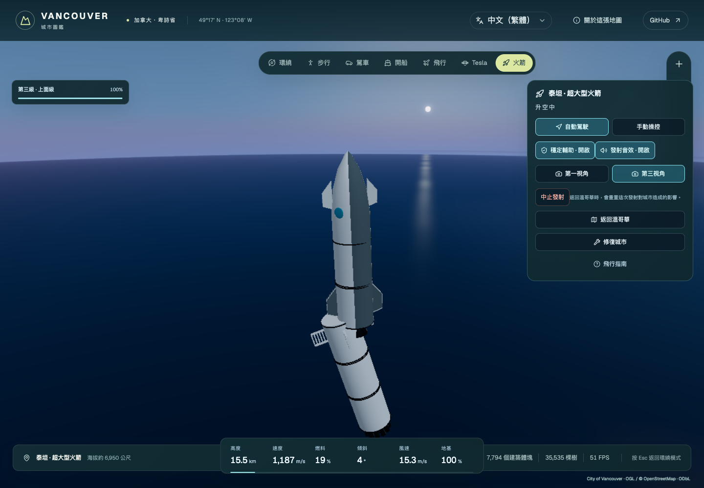

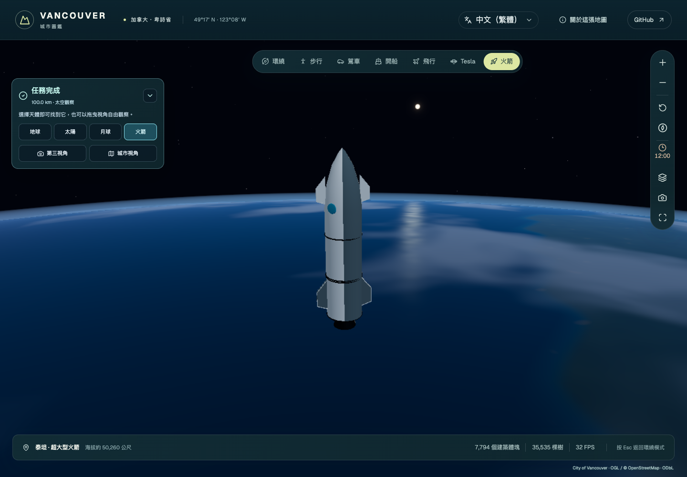

本輪 Titan 以 **69.517 模擬飛行秒**達到 **100,037.411 m**。離地 1.017 秒可見核心與四側噴流、40 條地面火焰帶；到 5.017 秒、高約 564.9 m 時，地面直接火焰已為 0。同一地面各型離地 5.017 秒的受損建築部件為 **0／14／91**，最遠中心距離約 **0／73.5／179.5 m**，是此地點當次觀察，不保證其他發射一樣。三型回城後建築 position／color 原始位元 hash 都還原至基線 **3116572666**。

完整結果見[四助推器城市報告](titan-four-runtime-report.json)、[模型報告](titan-four-model-report.json)及[測試摘要](titan-four-test-summary.json)。城市驗收以 production `update(1/60)` 固定步進，沒有指定高度、熱量、損壞計數或成功狀態；高角度圖只改 orbit 相機。模型展示只正規化顯示高度比較外形，這些都不是自然飛行時間、即時 FPS 或真實軌道力學證據。另有[12 組 HUD](titan-four-hud-layout-report.json)與[10 組 chooser](titan-four-chooser-layout-report.json)隔離 DOM 版面觀察，獨立於 npm 單元測試數量。

## 先前 Titan 首版：三型模型與城市驗收

以下圖片是加入四枚外掛前的歷史版本，保留原始圖檔與結果。

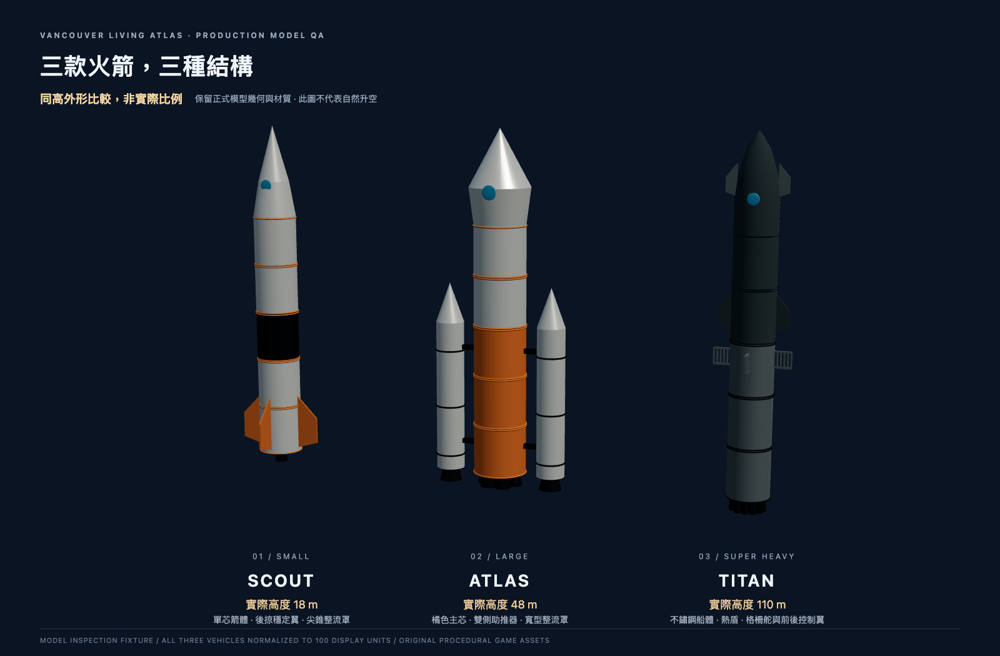

模型展示取自 production 模型，為比較外形把三款顯示高度正規化；標示的實際設定仍為 18／48／110 m。它不是自然飛行證據，也不表示三款實際一樣高。

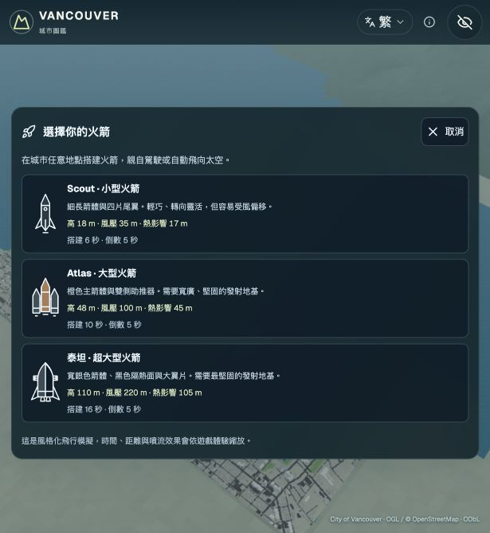

### 先前 Titan 首版的實際城市升空與同地點對照

先前首版在同一個量測過的開闊 ground site 依序發射三型，離地約 5 秒時受損建築部件為 Scout／Atlas／Titan **0／14／89**，最遠受損部件中心距離約 **0／73.5／179.5 m**。這是該位置、該舊版的一次對照，不是每次發射的保證數量。Titan 的物件／粒子池維持上限，三型回城後建築 position／color 原始位元 hash 均回到基線 **3116572666**。

當時 Titan 實際經過第一級燃盡、級間分離和上面級點火，以 **65.167 模擬飛行秒**達到 **100,030.692 m**，出現任務完成。這是尚無四枚外掛的兩級紀錄；驗收呼叫 production `update(1/60)` 並在步進間繪製，沒有指定高度、損壞計數或成功狀態。這是固定步進的實際遊戲 runtime，不是即時 FPS、自然牆鐘時間或真實軌道力學驗證。當時頁面未捕捉錯誤為 0，console 記錄另保留於[舊版城市報告](titan-runtime-report.json)。

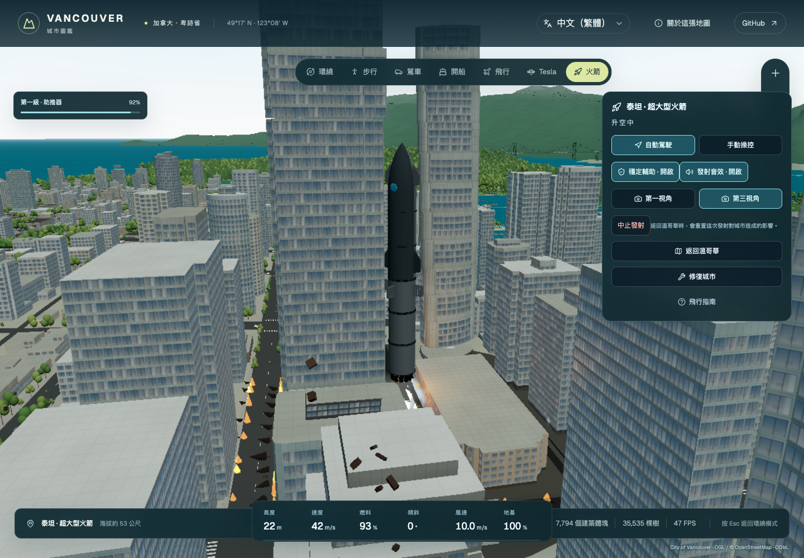

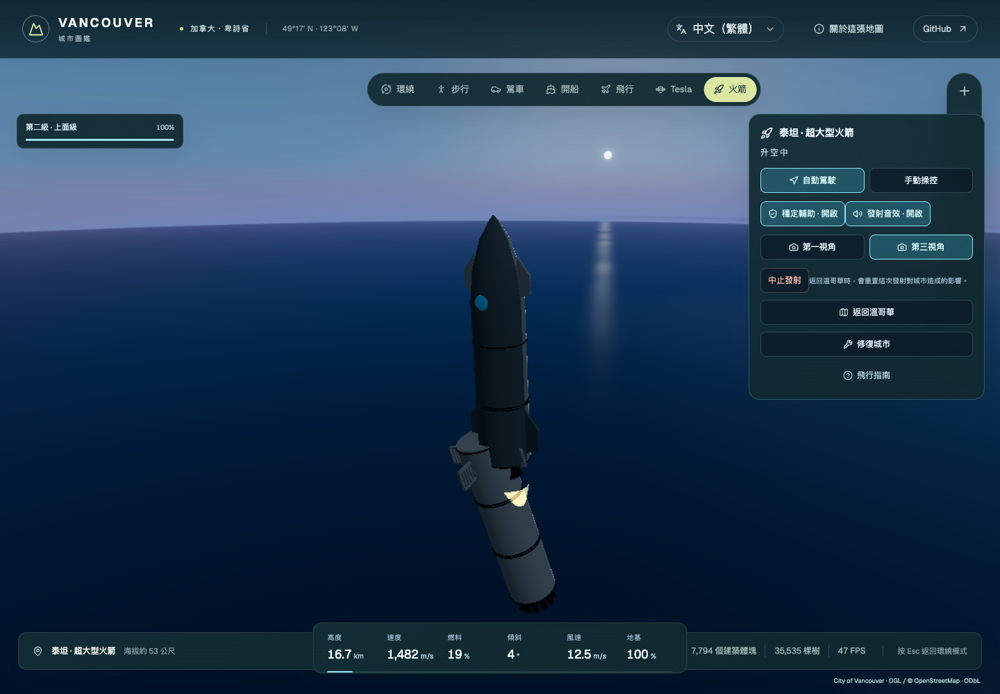

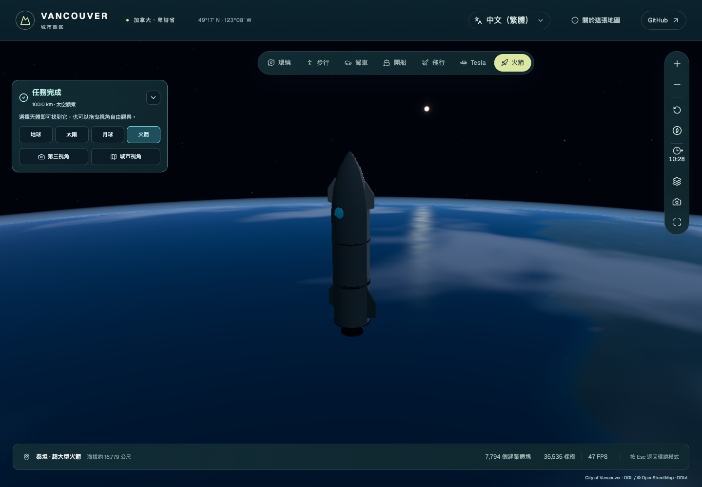

[英文／繁中各五種尺寸的 10 組隔離 DOM 版面檢查](three-choice-layout-report.json)，確認選擇卡不水平溢出，最小 320 × 568 捲動後取消與 Titan 卡仍可點。這些 browser 版面觀察在 2,001 項 npm 測試之外；17 項 UI 單元測試已包含於該總數，不重複加總。

## 先前兩型驗收：級間分離、上面級與太空觀察

[級間分離](evidence/integrated-stage-separation.png) · [上面級進入太空](evidence/integrated-upper-stage-space.png) · [太陽觀察](evidence/integrated-sun-observation.png) · [月球觀察](evidence/integrated-moon-observation.png)

這組新版畫面來自實際生產控制器的加速步進驗收：第一級消耗燃料、助推器分離、上面級點火後繼續升空，直到任務完成；沒有指定成功狀態或把高度直接設為 100 km。大小火箭分別在 **65.633／65.633 模擬飛行秒**越過 100 km，這是從離地開始的飛行時間，不含搭建與倒數，也不是測試程式的牆鐘時間。

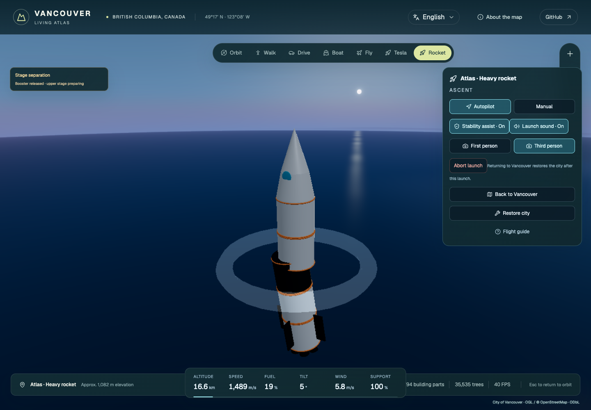

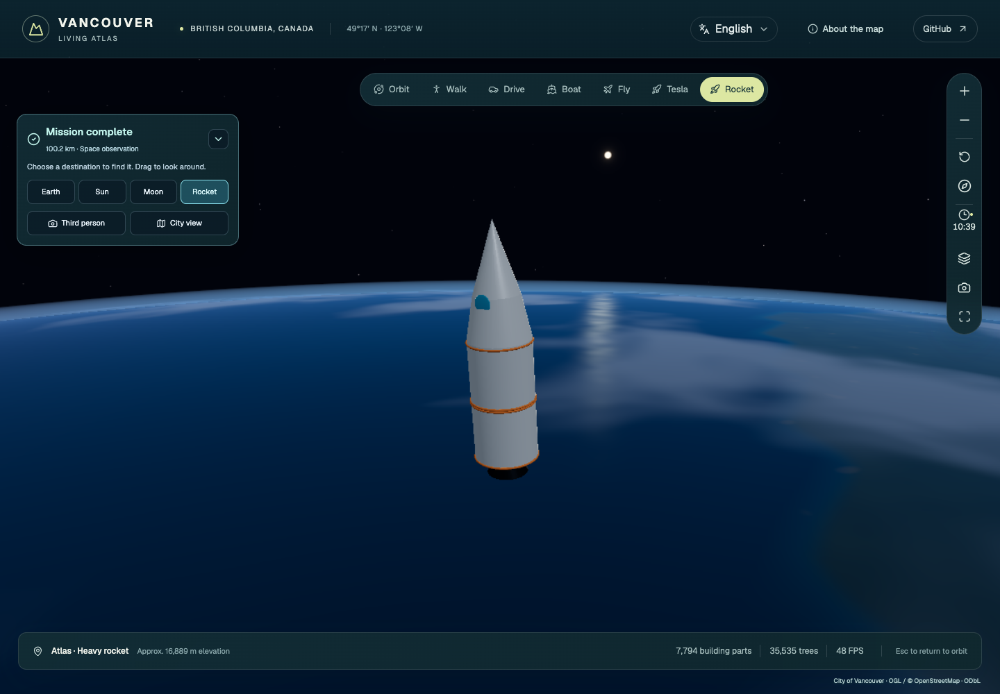

完成後直接顯示小型太空觀察卡，可選 Earth／Sun／Moon／Rocket，並切換第一／第三視角或回城市；任務詳細結果預設收折。以下日月畫面由驗收程式點擊實際 Sun、Moon 按鈕取得，兩個焦點均通過置中檢查。

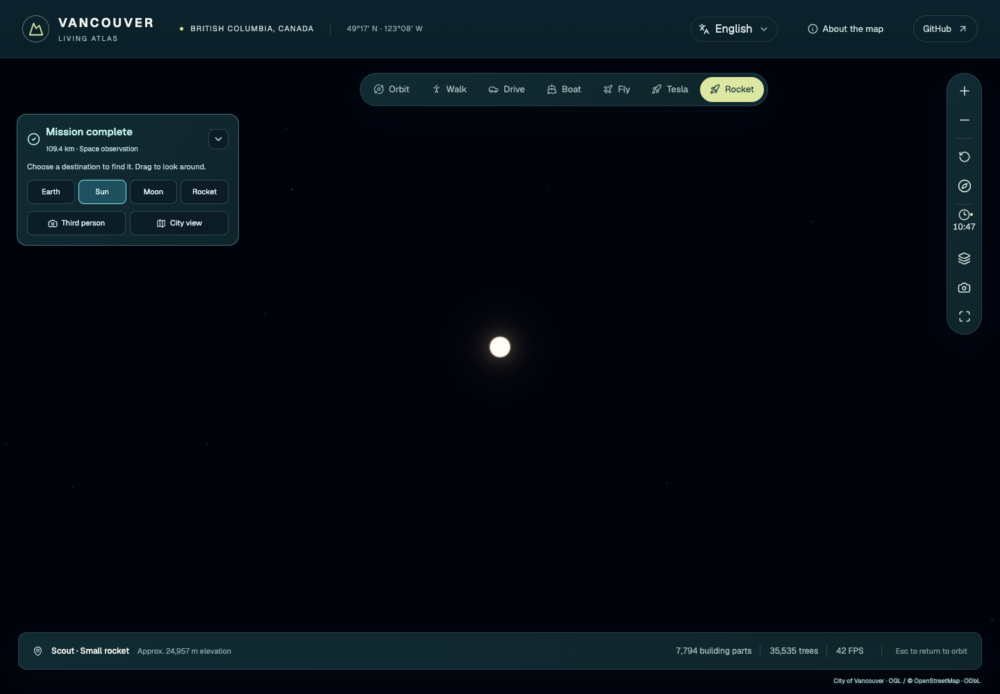

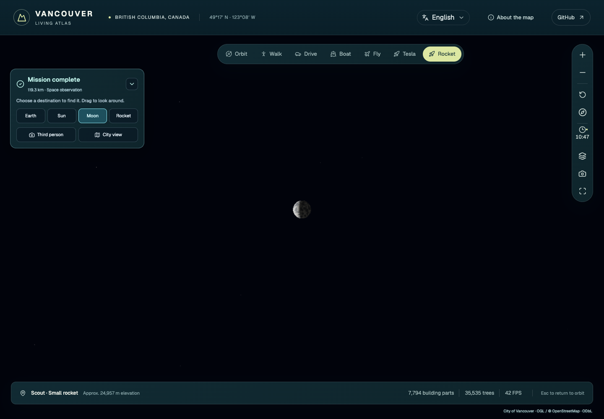

[修訂前 21／21 項整合驗收](runtime-acceptance.md)附完整方法、數值與可重跑腳本；[原始報告](runtime-report.json)保留各階段狀態、事件與檢查結果。該次城市發射記錄到 16 個受損建築部件、15 棵起火樹木與 67 個碎片；實際小屋頂上的大型火箭造成支撐垮塌、1 個建築部件受損與 5 個碎片。

完整規劃、來源與架構見 [火箭遊戲規格](../ROCKET_LAUNCH_GAME.md)。

## 先前事故演進與觀看時間：13／13 項驗收通過

屋頂受損後約以 2.6 秒逐步形變、下沉；支撐失效即關閉引擎，火箭先在失效支撐上沉降約 1.5 秒，再自由下墜，實際撞擊地面或城市。形變與支撐釋放可重疊，不是把兩段時間相加後才開始墜落。完整箭體撞擊後由原來六節機身與零件拆開、翻滾和落地；已完成級間分離時只處理仍相連的上面級。燃料與撞擊條件決定是否延遲爆炸，不是每次墜毀都立即爆炸。

森林火焰會先累積箭體熱量，依 seed 決定的脆弱程度產生不同結果：可能安全飛離、起火後冷卻熄滅，也可能持續內部燃燒，在升空後才爆炸。火光、煙霧與爆炸位置跟著箭體／殘骸移動。飛行中起火仍可操控與中止，介面顯示箭體起火和溫度。

事故發生於第一視角時會自動切第三視角追看，並平順尋找避開鄰樓的觀察方向。地基崩塌、下墜及撞擊／爆炸後前 5 秒只顯示小字原因與時間軸，提示位於底部至少 96 px 的安全區，不與城市底欄重疊。從最後一次實際爆炸重新計滿 5 秒，才以 680 ms 淡入重建、新火箭、修復城市與回城選項。沒有爆炸則從撞擊起算；Esc 仍可提前回城。手機隱藏 HUD、精簡顯示或已展開 options 都使用相同規則，減少動態效果設定則略過淡入動畫。

[本輪事故驗收方法與 13 項結果](runtime-acceptance.md)、[獨立事故 JSON 報告](accident-runtime-report.json)保留真實事件：屋頂 t≈8.0667 秒開始垮塌，10.6333 秒撞擊成六節，11.3167 秒延遲爆炸；最後爆炸後 4.8 秒無選項，5.15 秒操作面板已出現並通過淡入檢查。此處是包含搭建與倒數的模擬 elapsed，與上方從離地計算的飛行秒數分開。

森林案例 t≈9.950 秒箭體起火，13.7167 秒於發射點上方 20.395 m 空中爆炸；另一次 seed 0、一般 Auto 從同一森林安全抵達太空。起火案例的近地暖機使用正常手動推力指令，再切 Auto，沒有直接設定 heat、fire 或 crash 結果。新增事故驗收 0 未捕捉 JavaScript 錯誤，2 筆 HTTP 404 在報告另外記錄；14 項 UI 測試另驗證 4.999／5 秒邊界、隱藏 HUD 與「箭體起火 → 箭體起火／爆炸」文案，不用空中先下墜來解釋火災。

最終 13 項事故檢查另外確認鏡頭避開鄰樓，以及修復城市不會重播屋頂坍塌或爆炸。修復後受損計數為 0、支撐碰撞體為 0、屋頂恢復記錄清空，舊衝擊波保持結束狀態；淡入 opacity 實測由 0.119376 到 1。原始報告的 `httpFailures` 為空。

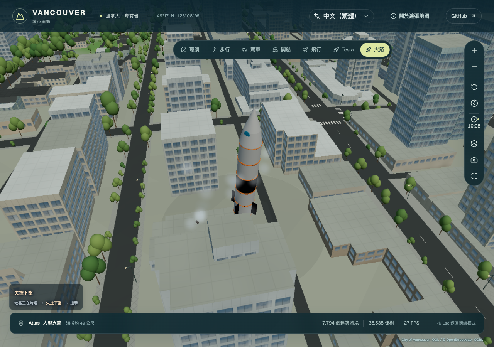

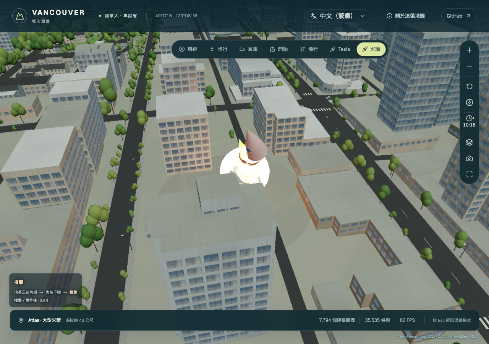

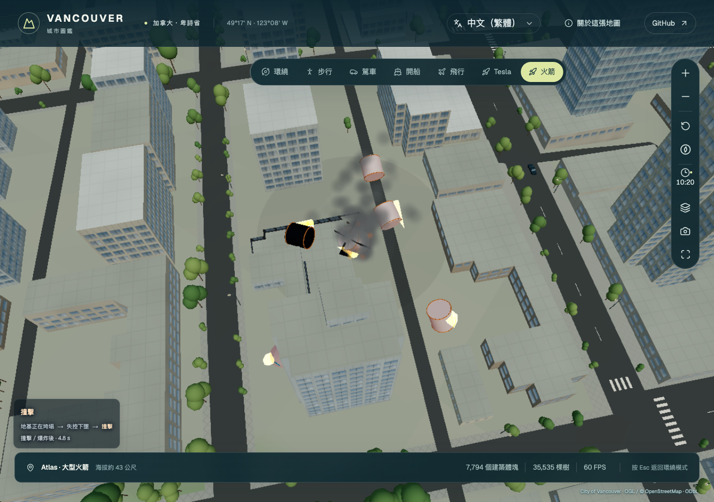

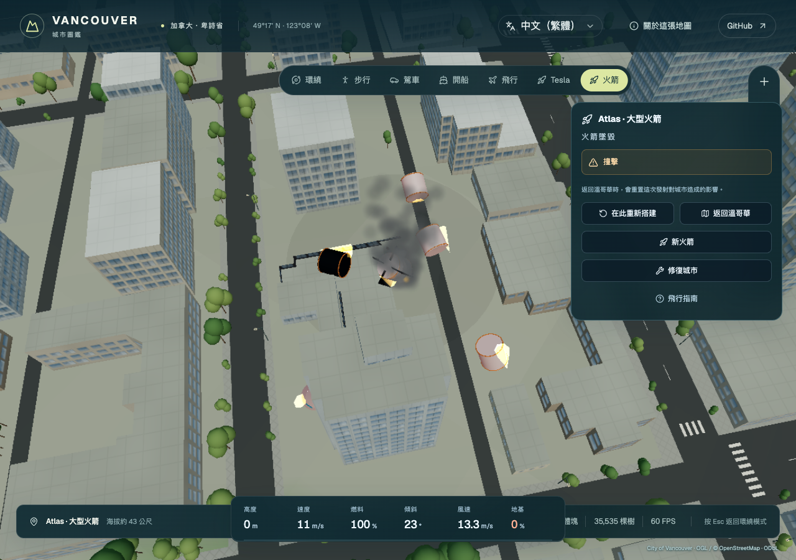

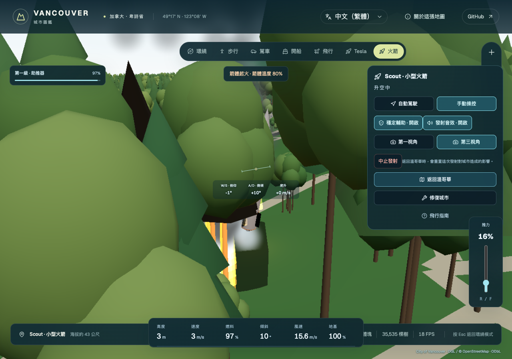

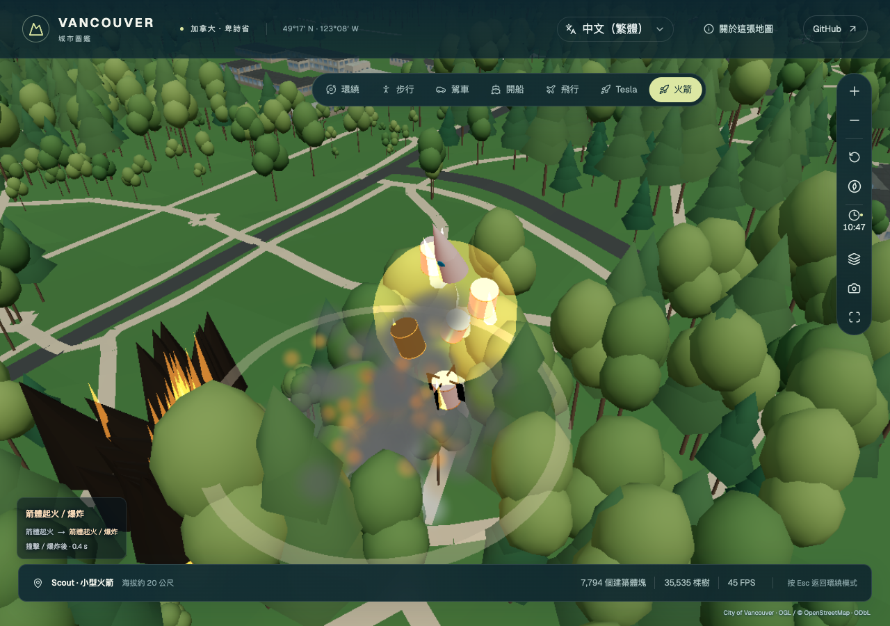

## 新版自然時間飛行與小視窗

在 IAB 一般圖形模式從史丹利公園實際點選地面、搭建、倒數，自然飛經第一級分離、第二級點火到任務完成，沒有透過測試程式設定高度或成功狀態。以下為該趟飛行中的第二級，以及完成後持續滑行的實際畫面；觀察時高度會繼續增加，並非宣稱入軌。

615 × 669 小視窗的完成卡改置下方安全區，讓鼻尖與中央箭身完整可見；390 px 手機尺寸同樣置下方，橫向與寬桌面維持側邊。展開結果會在卡內捲動，回城操作持續可用。

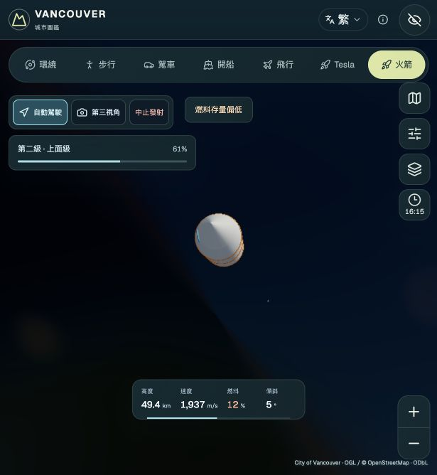

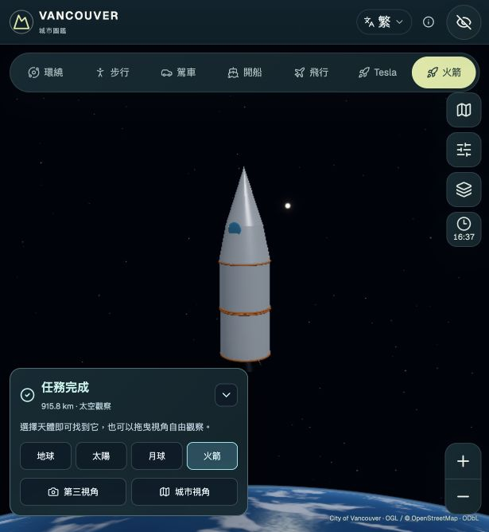

## 首輪自然時間的大型火箭發射（歷史畫面）

這張保留第一輪開發時從史丹利公園點選放置、搭建、倒數和自然升空的畫面；該趟抵達 100 km、完成任務，再切第一視角與返回城市。它早於新版兩級分離、加快升空節奏與太空焦點介面，不能用來代表目前約 65.6 秒的模擬飛行時間。

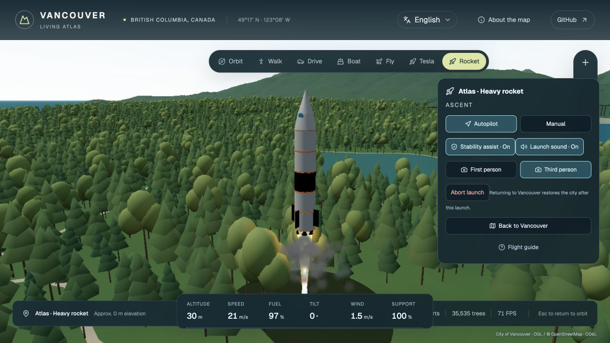

## 手機預發射介面實測

390 × 844 viewport 的短卡保留箭體與搭建架視野，完整設定由 options 展開；這是桌面 Chrome 的響應式 UI 驗收，沒有宣稱實機手機效能。

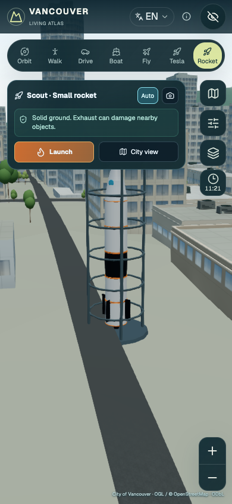

## 手動第一視角與雙指操作：UI fixture

姿態 HUD 顯示有方向的 pitch、roll 和爬升速度。此張用已知姿態與高度建立 **UI fixture**，專門確認顯示與佈局，不作完整升空或實機效能的證據；修訂前兩級上升物理與手動切自動任務由上方 21 項整合驗收覆蓋，本輪事故另外有 13 項實際城市驗收。

原生觸控事件也驗證了左側搖桿保持輸入時，第二指可獨立調整右側推力；隱藏 HUD 仍保留核心操控與中止。這是控制綁定實測，與 fixture 的預設飛行姿態分開解讀。

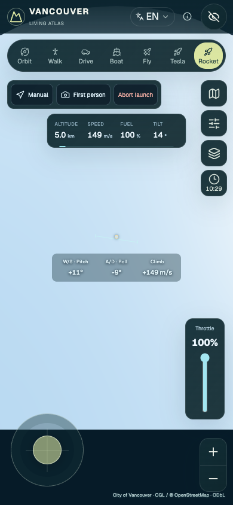
