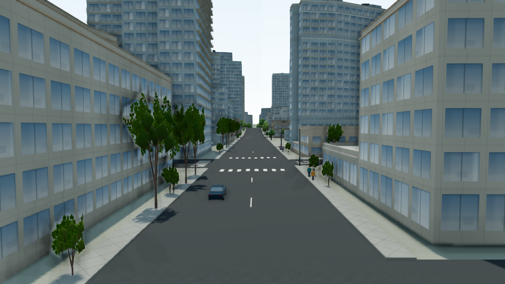
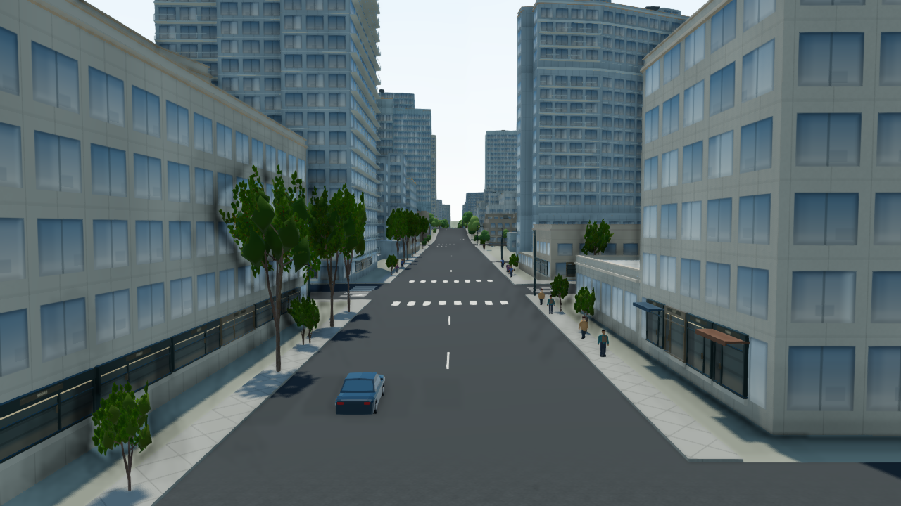
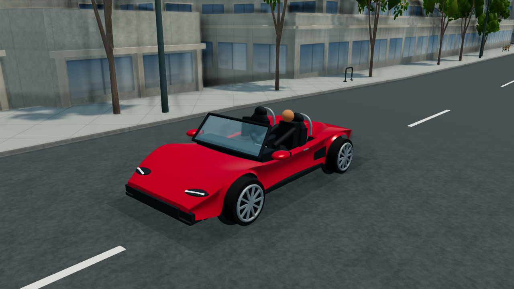
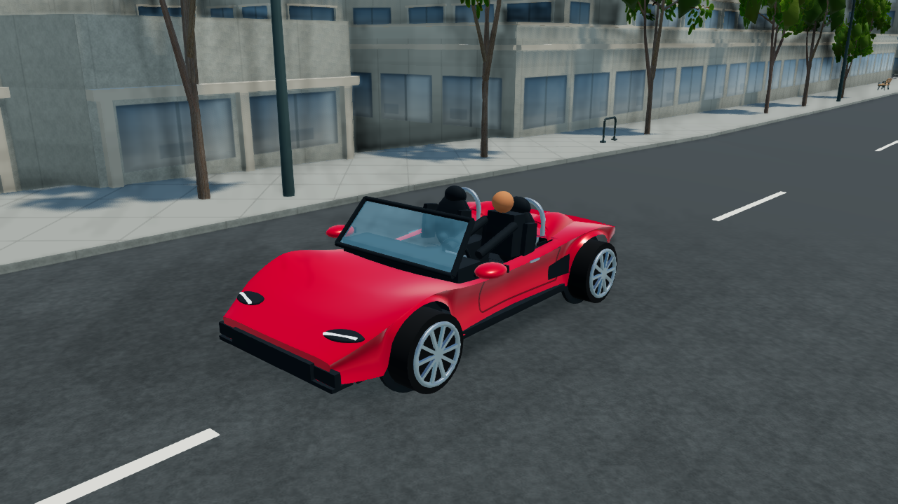

# Robson／Burrard 第一輪：畫面、效能與界線

本輪增加臨街一樓細節、材質分離、局部光照、較低的追車構圖與較密的人流。**端到端 FPS 沒有因此普遍變快：同鏡頭街角約下降 7–9%，Burrard 約下降 3%。** 獨立診斷顯示 CPU 耗時下降，但整體幀率仍有退步；目前資料無法把差異單獨歸因於 GPU 或任何一項改動。目前維持局部試點，不向整座城市擴張。

## 版本與原始畫面

- 基準應用：[`28b3bb55`](https://github.com/YiTaChen/vancouver-living-atlas/commit/28b3bb55af6f266b0b44e7b5c06a1d6d61c960c1)；核心 runtime：[`43559a91`](https://github.com/YiTaChen/vancouver-living-atlas/commit/43559a91a55b08fc8bc21313ae8cf38dac18d8ea)。
- 正式 recorder-off 擷取：[`e8c3506c`](https://github.com/YiTaChen/vancouver-living-atlas/commit/e8c3506c62264a24e7c034053cfd182502213507)；recorder-on 診斷擷取：[`766fbbff`](https://github.com/YiTaChen/vancouver-living-atlas/commit/766fbbffe0f81ea43243177699b861e0ff162fec)。
- [機器可讀結果與來源摘要 SHA-256](results.json)；[方法／保留條件](README.md)。四張圖片皆為原始 1280×720 PNG，未修圖；來源與複本雜湊相同。

| 同鏡頭場景 | 升級前 | 升級後 |
| --- | --- | --- |
| Burrard eye，窗口 05 |  |  |
| Roadster 固定觀察，窗口 06 |  |  |

## 正式主結果：關閉效能 recorder

同一 Radeon Pro 560X／ANGLE Metal、Chrome 155、Node 24.22.1；手動 High、1280×720 drawing buffer、clear、固定時鐘。每窗口先等待 12 秒，再記錄可見頁面的 12 秒 raw RAF；背景建置／測試／其他 3D 分頁停止。七對窗口皆有效，設定與 buffer 一致；固定觀察的相機／目標／FOV 一致，動態 actor 相位沒有凍結。

| 窗口 | 場景 | FPS 前 → 後 | p95 ms 前 → 後 | Calls 中位 前 → 後 |
| --- | --- | ---: | ---: | ---: |
| 01 | 街角 14:00，同鏡頭 | 22.77 → 20.69 | 66.8 → 67.6 | 1,061 → 1,063 |
| 02 | 街角重複 14:00，同鏡頭 | 23.55 → 21.47 | 50.6 → 67.1 | 1,077 → 1,083 |
| 03 | Robson 追車 14:00，構圖改變 | 22.94 → 21.55 | 51.3 → 67.6 | 974 → 996 |
| 04 | Robson 追車 23:00，構圖改變 | 20.91 → 21.14 | 66.7 → 66.9 | 990 → 1,012 |
| 05 | Burrard 14:00，同鏡頭 | 23.74 → 23.03 | 68.0 → 67.4 | 557 → 563 |
| 06 | Roadster 固定觀察，同鏡頭 | 22.04 → 22.14 | 67.7 → 67.0 | 1,076 → 1,082 |
| 07 | Robson 連續駕駛，構圖改變 | 19.42 → 20.44 | 83.7 → 82.4 | 902 → 879 |

另以**候選先、基準後**重跑兩對：街角 22.94 → 21.22 FPS（−7.5%），Burrard 23.92 → 23.17（−3.1%）。它們支持退步方向，但不是跨裝置統計證明。追車／移動窗口改了構圖，不能把其 FPS 差異歸因為最佳化；車輛近景的 +0.4% 也不作實質提升宣稱。

Calls／triangles 是多 pass 的提交量，非唯一可見幾何。行人為窗口結束 snapshot，例如 Burrard 18 → 31；沒有消融實驗能把材質、光照、人流與其他成本逐項分離。啟動、首次資產準備，以及較早的 baseline／calibration 探索圖不混入主結果。

## 獨立 CPU／GPU 診斷

以下來自另一組 recorder-on 窗口，不能與上表拼成同一幀的因果分析。CPU 使用配對共同窗口；GPU 只使用依 frameId 配對的有效非同步 timer，共同尾段約 4.9–6.2 秒，並非完整 12 秒。主結果關閉 recorder，CPU／GPU 留為 unavailable，不填零或由 CPU 相減推估。

| 同鏡頭場景 | CPU p50 ms 前 → 後 | GPU render p50 ms 前 → 後 |
| --- | ---: | ---: |
| 街角 01 | 31.9 → 27.3 | 25.63 → 25.88 |
| 街角 02 | 30.1 → 27.2 | 25.57 → 25.93 |
| Burrard 05 | 28.0 → 21.8 | 25.35 → 25.76 |

CPU 有改善，GPU render 略升；這不能證明 FPS 退步只由 GPU 引起。交通打包移入 renderScene 後，單看 traffic span 也不再代表整條交通處理成本。

## 查詢微量測與檔案預算

來源道路的 2,000 個查詢位置，每輪 20,000 次、七輪暖態交替順序：批次中位 **192.42 → 55.74 ms（−71.0%）**，逐查詢與 checksum 等價。這是 CPU 微量測，不是城市 FPS 增幅。小型 fixture 的 cache 是 147,504 bytes；完整來源共享 asphalt index 的額外 cache 為 **9,037,752 bytes／8.62 MiB**。交通與導航／漂移／Tesla／飛行／火箭皆會查詢這個共享索引；其他獨立建立的地面／導航／室內索引不配置這份 cache。

| Production dist/client | Raw bytes 前 → 後 | 逐檔 gzip 加總 前 → 後 |
| --- | ---: | ---: |
| JS，14 檔 | 6,684,587 → 6,715,007 | 2,304,398 → 2,314,906 |
| CSS，2 檔 | 292,778 → 292,778 | 48,577 → 48,577 |
| 全部，147 檔 | 64,817,111 → 64,847,531 | 29,419,645 → 29,430,153 |

gzip 採 level 9／mtime 0，排除已有 `.gz` 副本；JS 增加 30,420 raw／10,508 gzip bytes。全部檔案加總不是初始載入量、repo 容量或實際 CDN 傳輸量。兩側 production JS 的六個 pilot-QA marker 均不存在；精確 budget 來源版本記於 results.json。

## 做了什麼、保留了什麼

沿既有道路與 footprint 放置代表性外牆玻璃、門片、框料、基座、雨棚與通用招牌；不變更 GIS、碰撞、室內或新增入口。街面層最多六個共享池、100 個可見單元／1,800 方體，使用 512×256 招牌圖集；外觀層不參與 picking／相機碰撞／travel occlusion。

原有車輛／飛行載具幾何、動畫與材質資源繼續使用；本輪沒有下載或移植第三方模型／貼圖。材質遮罩限定於試點；光照則由近地面試點相機啟動，會影響當下整張畫面，離開或進入不適用模式後還原。交通仍模擬所有 actor，只按最終鏡頭打包可見實例；行人只增加有逐段通行證據的來源區間。

原授權、模型與歷史離線 QA／fixture hashes 保留。新相容性收據只扣除已審閱的有限 source delta，其餘完整來源 bytes 仍受原雜湊防護；這不等於已手動重玩所有飛行、火箭或公共運輸情境。

## 驗證與重跑

- [已通過的核心 CI：run 40033399979](https://github.com/YiTaChen/vancouver-living-atlas/actions/runs/40033399979)，版本 `766fbbff`：2,615 項，2,614 pass／0 fail／1 skip。
- Recorder 驗證 14/14、TypeScript、架構 validator 與 production build 已通過；**交付精確 head 的狀態以 [PR #46 即時 checks](https://github.com/YiTaChen/vancouver-living-atlas/pull/46/checks) 為準**，不把先前 CI 結果套到後續 commit。

```sh
npm ci
VANCOUVER_STATIC_EXPORT=1 VANCOUVER_VISUAL_QA=1 npm run build
VISUAL_QA_PORT=4173 node tools/serve-visual-qa.mjs pilot-replay
```

使用 Node 24.22.1，分開服務兩個工作目錄（另一側使用不同 port），點選 `Pilot run: matched suite` 執行七窗口。主結果開啟 `/?runtimePerf=0`；獨立診斷使用 `/?runtimePerf=1&runtimePerfTrace=1&runtimePerfGpu=1`，分開保存。正常 `npm run build:firebase` 的 production verifier 會拒絕 QA 控制／QA shell；instrumented local build 使用上面的 `npm run build`，不以放寬 production gate 通過。

## 尚未完成

此輪仍是通用程序幾何上的局部改善：雨棚／門面重複、著色近似的室內深度、既有車輛造型與植栽輪廓依然可辨。沒有逐棟美術重製、真實商戶或完整店內，也尚未達成全城一致的高階成品感。

目前只有這台桌面 GPU 的短窗口，沒有手機、多 GPU、長時間或全模式等量實機證明。先處理固定鏡頭 FPS 退步並補裝置證據，再評估擴張；不以微量測或少數改善的畫面抵銷這些限制。
