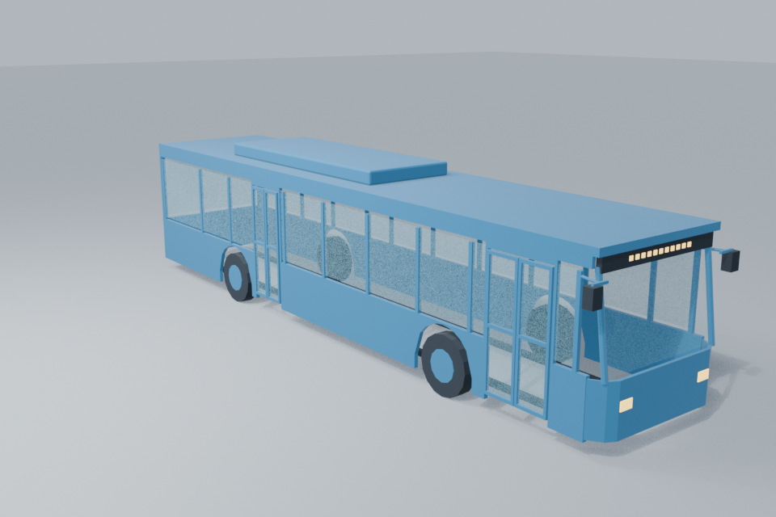
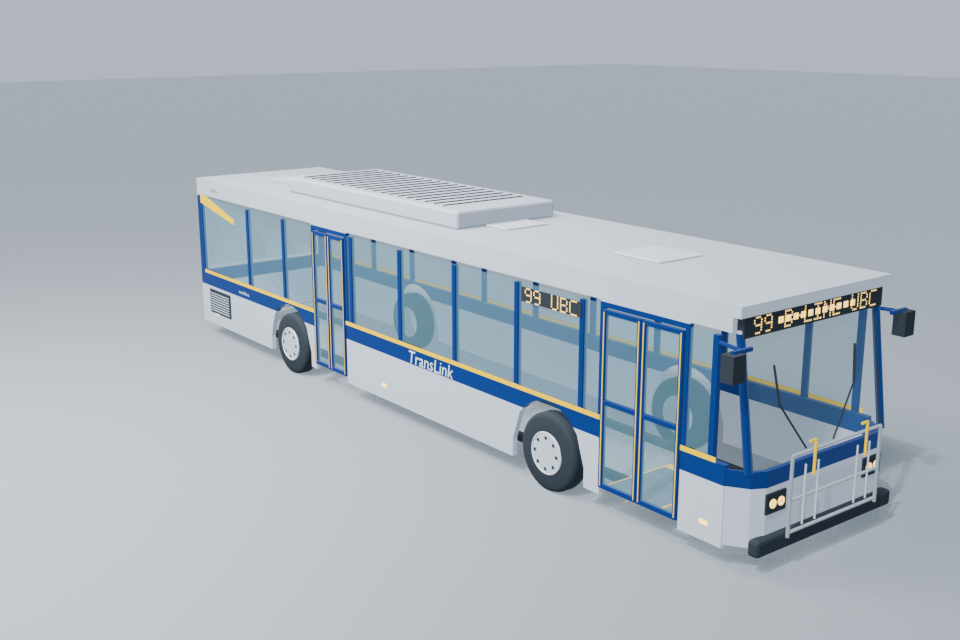
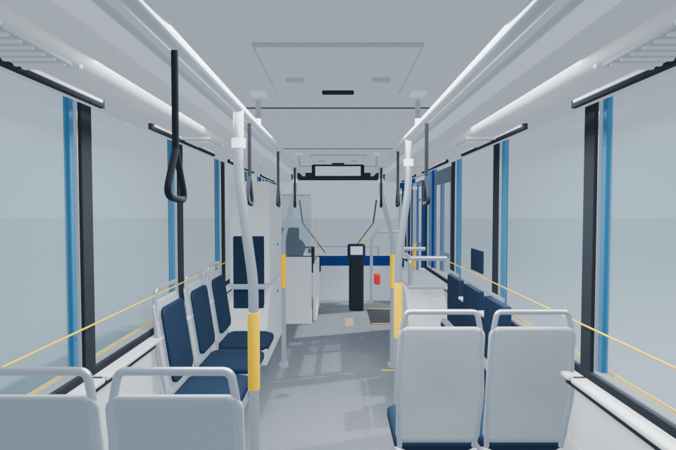
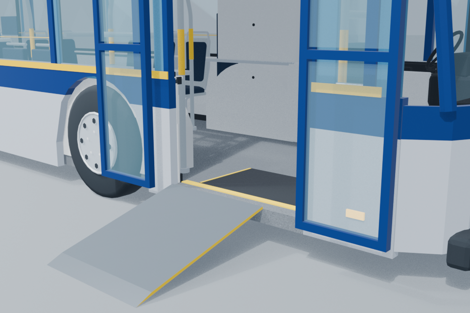
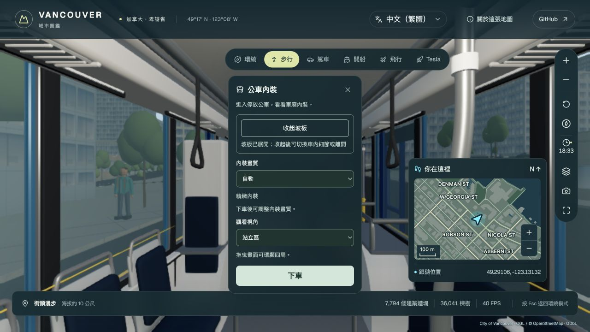
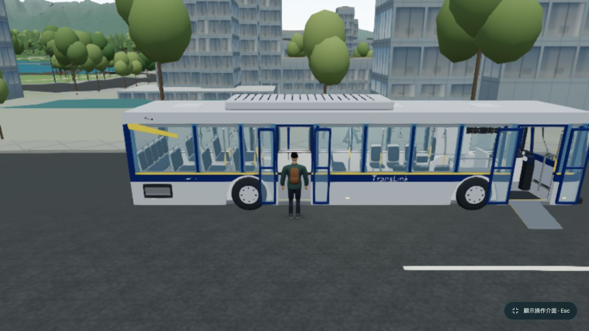

# TransLink 公車外觀、內裝與上下車整合

這次保留 Atlas 的低地板車體、門洞、車門動畫、座位與細緻內裝，再把影片版較清楚的銀灰／深藍／黃色塗裝、TransLink 字樣、頭尾燈、後視鏡、車頭腳踏車架及車尾細節做成符合原座標的外觀。影片版確實使用 Blender；它的完整車殼及內裝不適合直接取代可上下車的 Atlas 模型。

| 比較項目 | 影片版 | 原 Atlas | 整合後 |
| --- | --- | --- | --- |
| 外觀 | 夜間展示辨識度較高，細節較多 | 低成本通用外觀 | 採用 TransLink 外觀特徵，配合原車體尺寸 |
| 內裝 | 34 個較簡單座位、扶手與駕駛區 | 細緻駕駛艙、座椅、扶手、輪拱與階梯 | 保留 Atlas V2／closeup 內裝 |
| 主地板高度 | 0.75 m；後段 1.07 m | 0.36 m | 維持 0.36 m，另有代表性降低車身動作 |
| 車門 | 門後的連續車殼會擋住入口 | 已有實際門洞、四個車門動畫 | 保留門洞及動畫，另加前門坡板 |
| 即時外觀幾何 | 移除特技硬體後仍有 176,242 三角面 | LOD0 2,342 三角面 | LOD0 8,864／LOD1 4,920／LOD2 302 三角面 |
| 人物互動 | 沒有上下車或導航結構 | 按鈕上下車與固定車內視點 | 保留既有互動，提供後續通行所需的坡板平面 |

細緻內裝的 278,528 三角面只在既有 closeup 參觀模式使用；交通中的低成本內裝仍依原有載入規則處理。模型品質以同位置的實際畫面比較，三角面數只作成本紀錄。

## 真實車輛資料如何影響模型

[TransLink 操作手冊 §2.53.3–2.53.4](https://www.translink.ca/-/media/translink/documents/about-translink/freedom-of-information/cmbc-operator-policy--procedures-manual.pdf) 說明有坡板的公車應先降低車身以減少坡度；有需要的步行乘客、使用助行器或推嬰兒車的乘客也可以使用。這不是只為輪椅設計的道具。

[TransLink 站點設計指南，第 52–53 頁](https://www.translink.ca/-/media/translink/documents/plans-and-projects/roads-bridges-and-goods-movement/design_guide_bus_stops_adjacent_to_cycling.pdf) 的典型坡板伸出長度為 1.12 m。本模型採用這個長度及 0.86 m 寬度，並保留入口刷卡機旁的通道。坡板中心位於車體 Z=4.45 m，避開刷卡機底座及突出螢幕。

[Nova 2014 年 12 月典型 LFS 規格，第 2 頁](https://novabus.com/wp-content/uploads/2017/09/2014_Technical-Specifications-EN-LR.pdf) 列出正常 14.6 吋、降低後 11.6 吋的上車高度。因此本版本用 0.0762 m 作為可調參考值。這是代表性模擬參數，並非確認車號 7416 或全車隊具有相同的尺寸、懸吊或認證。不同車型若採單側跪式懸吊，可在後續更換專用 rig；目前模型沿垂直方向降低車身並保持四輪著地。

## 控制與限制

- 只有具有完整 rig 與明確 metadata 的停靠公車會顯示坡板控制。先開前門，再降低車身，接著翻出坡板；收回時順序相反。
- 坡板末端使用實際地面取樣，檢查高差、寬度方向的高低差、展開路徑及人物位置。展開範圍有人或障礙物時拒絕動作。
- 自動停靠先沿用原本的車體與前後門出口檢查，再優先選擇能承接坡板的候選位置。選位只做落點檢查；使用者展開時仍須通過完整路徑檢查。找不到合適落點時保留原有參觀位置，坡板會說明無法展開的原因。
- 降低車身時四輪的世界座標不動，車內視點與座位隨車體移動。動作期間鎖住上下車；坡板未收回前鎖住更換模型與離開參觀。
- 原內裝的 8–10.5 mm 薄地板飾面位於收合坡板上方。僅容許原始飾面元件的精確包圍範圍內、距地板不超過 11 mm、翻轉起始 0.12 rad 的接觸，包含其細薄倒角邊緣；元件範圍外或較高的障礙仍會阻擋。
- **這次沒有加入車內自由行走或 NPC 導航。** 現有按鈕上下車、座位／站位視點維持原樣。坡板暴露世界座標通行平面及落點資料，但 `walkingEnabled` 明確為 `false`，目前地面人物不會直接穿過坡板。後續需接上地面→坡板→門口→走道的導航連結、膠囊碰撞與車內行走控制。

## 原始檔與載入成本

[資產套件說明](../../../tools/assets/boardable-bus-hybrid/README.md) 包含重製指令、座標、來源與幾何驗證；三份可編輯 Blender 檔放在 `tools/assets/boardable-bus-hybrid/source/`。完整的中立姿勢影片模型另外保存在 `reference/film-bus-upright-reference.blend` 供比較，未放入網頁載入路徑。

三個外觀 GLB 合計 802,276 bytes，沒有額外貼圖，沿用四個共用外觀材質角色。第一次符合載入條件時先驗證 LOD0+1 共 771,572 bytes；近距離交通會因此多保留 486,460 bytes 的 LOD0 快取。原本 15 個共用材質表面與最多四台近距離公車的限制保留。冷啟動總覽、禁止新載入或相容模式不會因這項修改提前下載模型。新資產載入或驗證失敗時，該實例持續使用原版外觀。

`tools/adopt-bus-hybrid.mjs` 將已審核的 GLB 與 manifest 放入 `public/models/blender/bus-hybrid/`，並更新 adoption inventory。Firebase 建置驗證會比對實際 GLB、可編輯來源與 manifest 的雜湊、大小、三角面、材質及車門結構；`.blend`、比較圖片及製作腳本不會進入公開網站成品。

## 本次驗證

- 全套 CPU／回歸測試：`node --test --test-concurrency=4 tests/*.test.mjs`，**1,464／1,464 通過**。限制並行數可避免同機其他建置使大型原始資產稽核逾時。
- TypeScript：`npm run check` 通過；新增控制器、載入器及檢查工具的相關 lint 通過。
- 正式網站：`npm run build:firebase` 通過，包含既有與新增的資產／來源隔離及雜湊驗證。
- 三份儲存後的 Blender 來源重新匯出，與已審核的 GLB 位元組相同。
- 在正式建置的本機 WebGL 網站，以繁體中文驗證 Overview 選位、人物擋住坡板時拒絕展開、按鈕上車、降低車身、展開、後門下車、收板及恢復車身。檢查到的瀏覽器主控台錯誤為 0。以下是實際網站截圖。

本機驗證使用 Node 26.0.0；repository 的既有 engine 與 CI 設定維持原樣。

